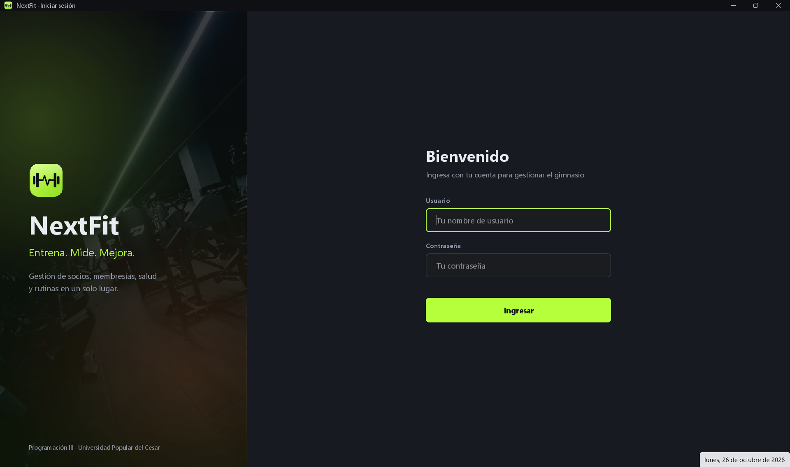
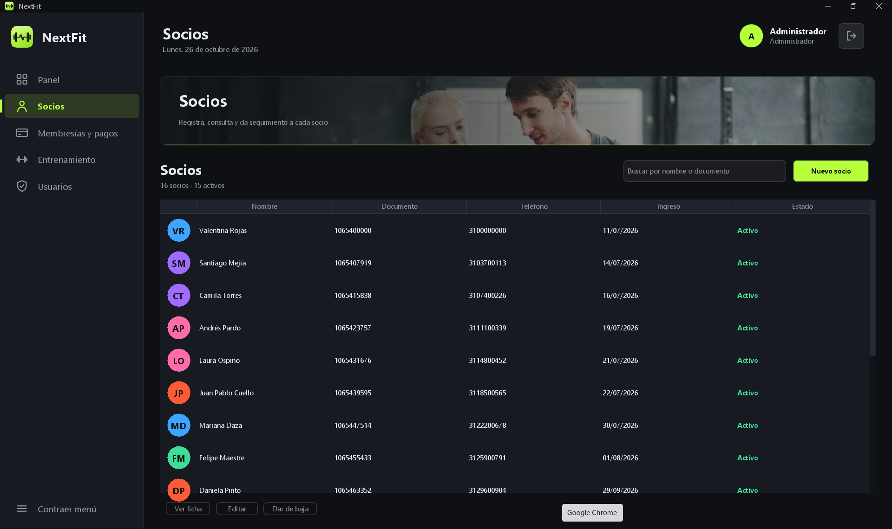
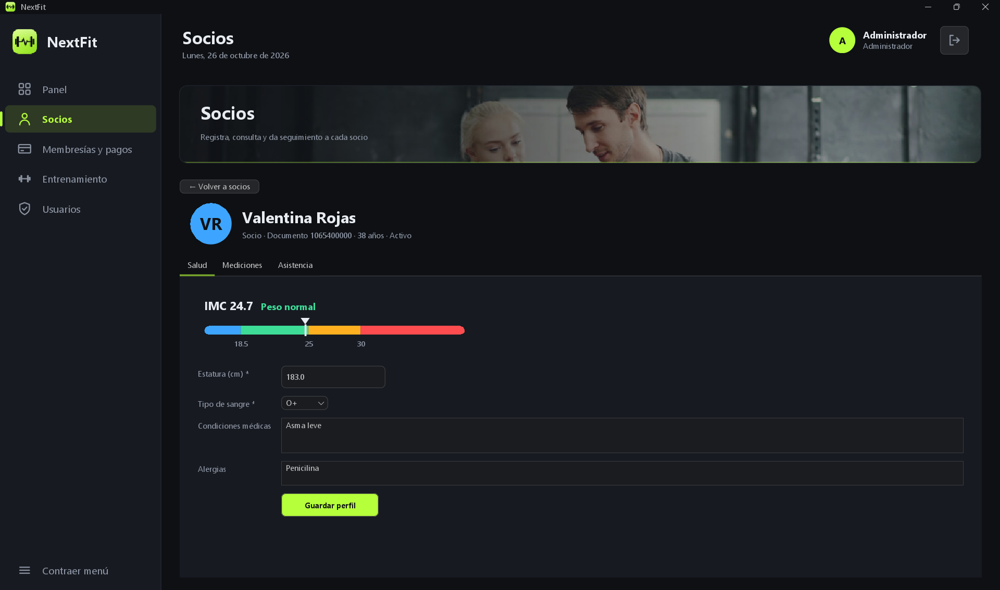
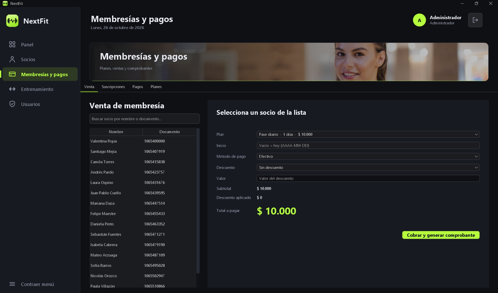
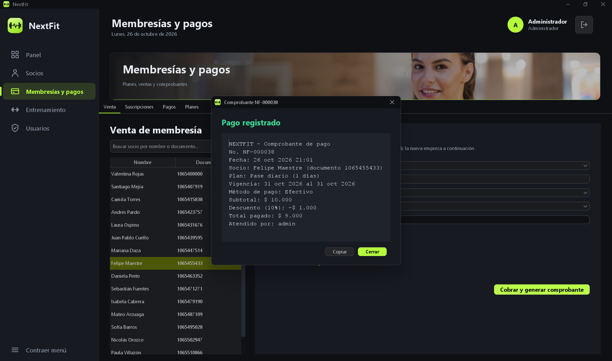
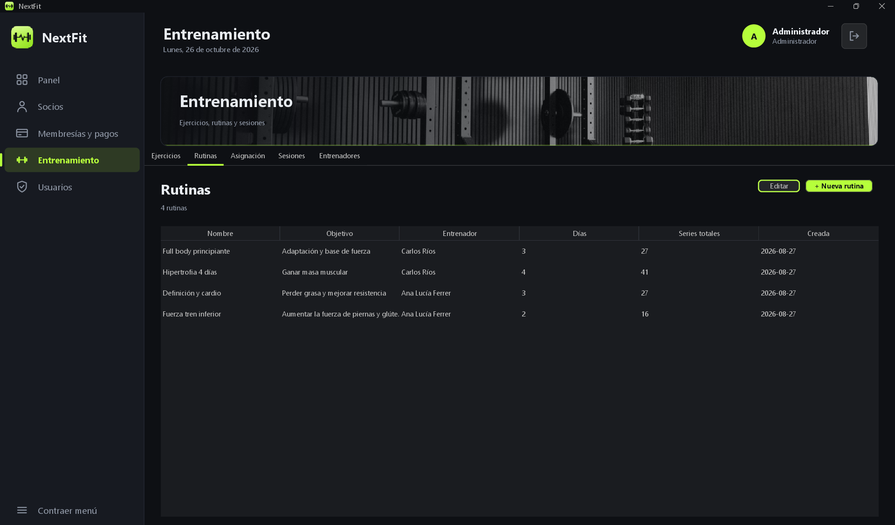
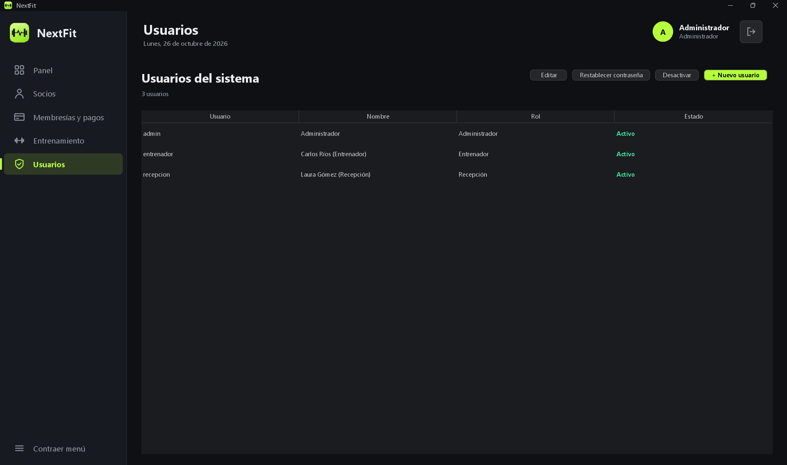
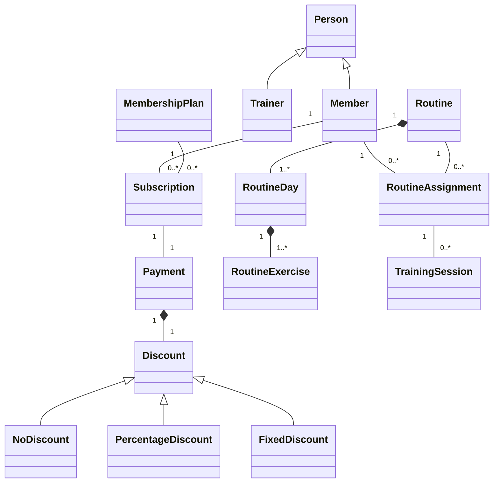

<div align="center">

# 🏋️ NextFit

**Gym management system with member health tracking and training routines**


Programación III · Universidad Popular del Cesar

</div>

---

## Table of contents

1. [About the project](#about-the-project)
2. [Features](#features)
3. [Screenshots](#screenshots)
4. [Roles and permissions](#roles-and-permissions)
5. [Technologies](#technologies)
6. [Architecture](#architecture)
7. [Project structure](#project-structure)
8. [Getting started](#getting-started)
9. [Demo data](#demo-data)
10. [Data storage](#data-storage)
11. [Business rules](#business-rules)
12. [Testing](#testing)
13. [Design principles (GRASP and SOLID)](#design-principles-grasp-and-solid)
14. [Documentation](#documentation)
15. [Team](#team)
16. [Credits](#credits)

---

## About the project

**NextFit** is a desktop application for managing a gym: members and their health data, membership plans and payments, attendance control, exercise catalog, routines and training sessions, all with a dashboard that summarizes the state of the gym.

It is built with **Java 21** and **Swing** (with the FlatLaf look and feel), following a **layered architecture** and object-oriented design principles. Information is stored in **CSV files**; there is no database yet, so the application runs anywhere with nothing but a JDK.

> This repository is the course project of *Programación III*. The current delivery corresponds to the **70 % milestone**.

---

## Features

### 🔐 Access and users
- Login screen with role-based access.
- Passwords stored as hashes (never in plain text).
- User administration (create, edit, activate / deactivate) with protections: you cannot deactivate your own account and at least one active administrator must always remain.
- A default administrator is created automatically on the first run.

### 👥 Members and health
- Register, edit and deactivate members, with photo, emergency contact and validated personal data.
- **Health profile**: height, blood type, medical conditions and allergies.
- **Measurements history**: weight, waist, chest and hips, with automatic **BMI** calculation and category (underweight, normal, overweight, obesity).
- **Attendance**: check-in / check-out of members, with the list of members currently inside the gym.
- Detail panel per member with tabs for health, measurements and attendance.

### 💳 Memberships and billing
- Membership plans (name, duration, price) that can be activated or retired.
- Sale of a membership to a member with a **payment method** (cash, card, transfer) and an optional **discount** (percentage or fixed amount).
- Automatic receipt with its number, subtotal, discount and total.
- Subscription list with computed status: *upcoming, active, expired, cancelled*, with days left; subscriptions can be cancelled.
- Payment history.

### 🏃 Training
- **Exercise catalog** with description, muscle group, difficulty and photo.
- **Routines** organized by days and exercises (sets, repetitions, rest time), created by a trainer.
- **Assignment** of routines to members who hold a valid membership (active, completed or cancelled).
- **Training sessions** log per assignment (day, duration, notes).
- Trainer management.

### 📊 Dashboard
- Indicators for active members, memberships about to expire, members inside the gym and income.
- Charts: memberships by status (donut), attendance by weekday (bars) and income of the last months (line), with a photo banner.

### 🧱 Quality
- Typed exception hierarchy with a different message per kind of error (invalid data, business rule, resource not found, storage problem).
- Validation centralized in one validator per functional area.
- Unit tests for services, validators, the demo data and several UI helpers.

---

## Screenshots

> Screenshots live in [`docs/screenshots`](docs/screenshots). Add the images with the file names below and they will show up here.

| Login | Dashboard |
|:--:|:--:|
|  |  |

| Members | Member detail |
|:--:|:--:|
|  |  |

| Billing | Receipt |
|:--:|:--:|
|  |  |

| Exercise catalog | Routines and assignments |
|:--:|:--:|
|  |  |

| Users |
|:--:|
|  |

---

## Roles and permissions

The sidebar only shows the modules that the logged-in role can use.

| Module | Administrator | Reception | Trainer |
|---|:--:|:--:|:--:|
| Dashboard | ✅ | ✅ | ❌ |
| Members (health, attendance) | ✅ | ✅ | ✅ |
| Billing (plans, sales, payments) | ✅ | ✅ | ❌ |
| Training (exercises, routines, assignments) | ✅ | ❌ | ✅ |
| Users | ✅ | ❌ | ❌ |

---

## Technologies

| Technology | Use |
|---|---|
| **Java 21** | Language (records, `java.time`) |
| **Maven** | Build, dependencies and tests |
| **Swing** | Desktop user interface |
| **FlatLaf** | Modern look and feel |
| **MigLayout** | Layout manager for forms |
| **CSV files** | Persistence (no database yet) |
| **JUnit 5** | Unit testing |
| **Git / GitHub** | Version control, feature branches and pull requests |

---

## Architecture

NextFit is organized in layers. Each layer only depends on the ones below it, and the domain (`model`) depends on nothing.

```text
┌──────────────────────────────────────────────┐
│  UI  (ui, ui.members, ui.billing, ...)       │  Swing screens
└───────────────────────┬──────────────────────┘
                        ▼
┌──────────────────────────────────────────────┐
│  SERVICE + VALIDATION                        │  business rules
└───────────────────────┬──────────────────────┘
                        ▼
┌──────────────────────────────────────────────┐
│  PERSISTENCE  (repositories + CSV)           │  interfaces and CSV implementations
└───────────────────────┬──────────────────────┘
                        ▼
┌──────────────────────────────────────────────┐
│  MODEL  (domain)                             │  entities, enums
└──────────────────────────────────────────────┘
        exceptions · util  →  cross-cutting
```

Key design decisions:

- **Repositories behind interfaces**: services depend on `MemberRepository`, not on CSV. Replacing the CSV files by a database later only means adding new implementations.
- **Dependency injection by constructor** with a composition root (`Main`), so every class is easy to test with fakes.
- **Immutable model**: entities are never modified in place; `withX(...)` methods return a modified copy.
- **Injected `Clock`**: services receive a `java.time.Clock`, which makes date-dependent rules testable.
- **Computed state**: the status of a subscription is calculated from its dates, never stored.
- **Modules as plugins of the window**: every screen implements `ModulePanel` and `MainWindow` hosts them; `BannerModule` decorates a module with a photo banner.
- **Money as whole pesos** (`long`), avoiding floating point errors.

The full diagrams (Mermaid) are in:

- 📦 [Package diagram by layers](docs/layers-diagram.md)
- 🧩 [Domain class diagram](docs/domain-class-diagram.md)
- 🗺️ [Integrated class diagram](docs/integrated-class-diagram.md)

### Domain model (summary)



---

## Project structure

```text
NextFit/
├── pom.xml
├── README.md
├── data/                          # CSV files (created on first run)
├── docs/
│   ├── layers-diagram.md
│   ├── domain-class-diagram.md
│   ├── integrated-class-diagram.md
│   ├── principles-traceability.md # GRASP / SOLID per member
│   ├── image-credits.md
│   └── screenshots/
└── src/
    ├── main/
    │   ├── java/com/nextfit/
    │   │   ├── Main.java          # composition root
    │   │   ├── TrainingModule.java
    │   │   ├── DemoData.java      # demo data seeder
    │   │   ├── exceptions/        # typed exception hierarchy
    │   │   ├── model/             # domain entities and enums
    │   │   ├── persistence/       # repository interfaces + CSV implementations
    │   │   ├── service/           # business logic
    │   │   ├── validation/        # one validator per area
    │   │   ├── util/              # PasswordHasher, PhotoStorage
    │   │   └── ui/                # screens: components, members,
    │   │                          #   billing, training, dashboard, users
    │   └── resources/images/      # logo, banners, login, exercises
    └── test/java/com/nextfit/     # JUnit tests
```

---

## Getting started

### Requirements

- **JDK 21** or newer
- **Maven 3.9** or newer (or the Maven integrated in NetBeans / IntelliJ)

Check your versions:

```bash
java -version
mvn -version
```

### Clone

```bash
git clone https://github.com/Deliner2501/NextFit.git
cd NextFit
```

### Run

From the terminal:

```bash
mvn clean compile exec:java
```

Or from the IDE: open the project as a Maven project and run the class `com.nextfit.Main`.

> The application must be started from the project root, because the `data/` folder is created relative to the working directory.

### Build a package

```bash
mvn clean package
```

### Sign in

On the first run the system creates the following users:

| Role | Username | Password |
|---|---|---|
| Administrator | `admin` | `admin123` |
| Reception | `recepcion` | `recepcion123` |
| Trainer | `entrenador` | `entrenador123` |

> Change these passwords from the **Users** module before using the system in a real environment.

---

## Demo data

To make the application look alive from the very first run, `DemoData` fills an empty installation with realistic data: membership plans, trainers, members with health history, subscriptions and payments spread over previous months, attendance records, the exercise catalog, routines, assignments and training sessions. As a result the dashboard shows meaningful numbers right away.

- It runs automatically at startup, **only when the installation is empty** (no members, plans, trainers or exercises). It never overwrites existing data.
- To start again from scratch, close the application and delete the `data/` folder.

---

## Data storage

Everything is stored as plain CSV files inside `data/`:

| File | Content |
|---|---|
| `users.csv` | System users (password hashes) |
| `members.csv` | Members |
| `health_profiles.csv` | Health profile of each member |
| `measurements.csv` | Body measurements history |
| `attendance.csv` | Check-ins and check-outs |
| `plans.csv` | Membership plans |
| `subscriptions.csv` | Memberships bought by members |
| `payments.csv` | Payments and receipts |
| `trainers.csv` | Trainers |
| `exercises.csv` | Exercise catalog |
| `routines.csv`, `routine_lines.csv` | Routines, their days and exercises |
| `assignments.csv` | Routines assigned to members |
| `training_sessions.csv` | Training sessions log |
| `photos/` | Photos uploaded for members and trainers |

Relations between entities are stored as identifiers (for example a subscription keeps the `memberId` and the `planId`). A shared `CsvStore` handles reading and writing, and one `CsvMapper` per entity converts between rows and objects.

---

## Business rules

Some of the rules enforced by the services (all of them covered by tests):

- A member can only buy a membership if they are **active** and the plan is still **available**.
- A subscription that already expired **cannot be cancelled**, and a cancelled one cannot be cancelled again.
- A **routine can only be assigned** to a member with a **valid membership**; the trainer of the routine must be active.
- Only an **active assignment** can be completed, cancelled or used for a training session, and it must belong to the member.
- A training session must refer to a **day that exists** in the routine.
- A member cannot check in twice without checking out, nor check out without an open entry. Inactive members cannot check in.
- Usernames are unique; you cannot deactivate your own user, and at least one active administrator must remain.
- Plan names are unique.
- Data validation, for example: age between 12 and 100 years, document between 5 and 12 digits, phone between 7 and 15 digits, height between 100 and 250 cm, weight between 20 and 400 kg, valid blood types only.

---

## Testing

```bash
mvn test
```

The suite covers services (members, health, attendance, plans, subscriptions, payments, exercises, routine assignments, training sessions, users, dashboard), the demo data seeder, formatting and receipt helpers, photo storage and UI helper components. Services are tested with in-memory fake repositories, so the tests need no files and run fast.

---

## Design principles (GRASP and SOLID)

The team keeps a traceability table that links every principle with the exact class and the commit where it was applied: see [`docs/principles-traceability.md`](docs/principles-traceability.md).

Some examples:

| Principle | Where |
|---|---|
| **Single Responsibility** | One service and one validator per functional area; one mapper per entity |
| **Open/Closed** | `Discount` hierarchy: a new discount type is a new subclass |
| **Liskov Substitution** | `Member` and `Trainer` can be used wherever a `Person` is expected |
| **Interface Segregation** | `SubscriptionChecker` exposes only what other services need from subscriptions |
| **Dependency Inversion** | Services depend on repository interfaces; implementations are injected from `Main` |
| **Information Expert** | `Subscription` computes its own status and days left |
| **Creator / Controller** | `Main` composes the application; services coordinate each use case |
| **Polymorphism** | `Discount.amountOff` and `Person.getPersonType` |
| **Low coupling / High cohesion** | Layers with one-way dependencies (see the package diagram) |
| **Decorator** | `BannerModule` adds a banner to any `ModulePanel` |

---

## Documentation

| Document | Description |
|---|---|
| [Layers diagram](docs/layers-diagram.md) | Package diagram by layers |
| [Domain class diagram](docs/domain-class-diagram.md) | Business classes, inheritance and relations |
| [Integrated class diagram](docs/integrated-class-diagram.md) | All the classes, split by module |
| [Principles traceability](docs/principles-traceability.md) | GRASP / SOLID applied per member and commit |
| [Image credits](docs/image-credits.md) | Authors and sources of the photos |

---

## Team

| Member | Role | GitHub |
|---|---|---|
| **Deiner De Luque** | Technical Lead | [@Deliner2501](https://github.com/Deliner2501) |
| **Ronald Mendoza** | Developer | [@rymendoza](https://github.com/rymendoza) |
| **Santiago Meza** | Developer | [@smmeza](https://github.com/smmeza) |

**Course:** Programación III · **University:** Universidad Popular del Cesar

### Workflow

- Work is done in **feature branches** (`feature/...`) that are merged into `develop` through **pull requests**; branches are not deleted after merging.
- Commits follow **Conventional Commits** (`feat`, `fix`, `docs`, `test`, `refactor`).
- Code, comments and documentation are written in **English**; the user interface is in **Spanish**.

---

## Credits

- Photos from [Unsplash](https://unsplash.com) and [Pexels](https://www.pexels.com); the authors are listed in [`docs/image-credits.md`](docs/image-credits.md).
- UI look and feel by [FlatLaf](https://www.formdev.com/flatlaf/).

---

<div align="center">

Made with 💪 by the NextFit team · 2026

</div>
