<div align="center">

# 🏋️ NextFit

**Gym management system with member health tracking and training routines**


Programación III · Universidad Popular del Cesar

</div>

---

## Table of contents

1. [About the project](#about-the-project)
2. [Features](#features)
3. [Screenshots](#screenshots)
4. [Roles and permissions](#roles-and-permissions)
5. [Technologies](#technologies)
6. [Architecture](#architecture)
7. [Project structure](#project-structure)
8. [Getting started](#getting-started)
9. [Demo data](#demo-data)
10. [Data storage](#data-storage)
11. [Business rules](#business-rules)
12. [Testing](#testing)
13. [Design principles (GRASP and SOLID)](#design-principles-grasp-and-solid)
14. [Documentation](#documentation)
15. [Team](#team)
16. [Credits](#credits)

---

## About the project

**NextFit** is a desktop application for managing a gym: members and their health data, membership plans and payments, attendance control, exercise catalog, routines and training sessions, all with a dashboard that summarizes the state of the gym.

It is built with **Java 21** and **JavaFX** (with the AtlantaFX theme and its own violet and lime design), following a **layered architecture** and object-oriented design principles. Information is stored in **CSV files**; there is no database yet, so the application runs anywhere with nothing but a JDK.

> This repository is the course project of *Programación III*.
>
> **Current state:** the interface is JavaFX, with a dark and a light theme, motion and a collapsible menu. Done: dashboard, members (table, form and member file), billing, training, access control, carnets, analytics, TV screen, reports and cash close, alerts, users, audit log and backup. The last step will be moving the storage from CSV files to a database.

---

## Features

### 🔐 Access, users and security
- Login screen with role-based access.
- Passwords stored as hashes (never in plain text).
- **Login lockout**: after 5 failed attempts the user is blocked for 5 minutes.
- **Inactivity**: the session closes after 15 minutes without activity.
- User administration (create, edit, reset password, activate / deactivate) with protections: you cannot deactivate your own account and at least one active administrator must always remain.
- **Audit log**: sign-ins (successful, failed, lockouts), sign-outs, expired sessions, user changes, backups and restores are recorded, and the administrator reads them in the **Auditoría** screen ([details](docs/audit-and-security.md)).
- A default administrator is created automatically on the first run.

### 👥 Members and health
- **Members screen**: table with photo, document, phone and status, and a search box (name, document or phone).
- Register, edit and deactivate members, with photo, emergency contact and validated personal data. The administrator and the reception can change data; the trainers can only read.
- **Health profile** (height, blood type, medical conditions, allergies), **measurements history** with automatic **BMI** and category, and the member **detail panel** live in the **member file** (button *Ver ficha*), with the tabs *Salud*, *Mediciones*, *Asistencia* and *Logros* (streaks and badges).
- **Attendance**: check-in / check-out of members, with the list of members currently inside the gym (see Access control).
- **Global search**: Ctrl+K or the magnifier in the top bar finds members (name, document, phone) and sections, ignoring case and accents; every module can add its own results through `FxModule.search`.
- **Alerts engine**: birthdays, memberships about to expire and members who stopped coming, each with a ready WhatsApp message (`service.alert`). The **Alertas** screen shows them in cards and a list, writes the message for the member and opens WhatsApp or copies the text (administrator and reception).

### 💳 Memberships and billing
- Membership plans (name, duration, price) that can be activated or retired.
- Sale of a membership to a member with a **payment method** (cash, card, transfer) and an optional **discount** (percentage or fixed amount).
- Automatic receipt with its number, subtotal, discount and total.
- Subscription list with computed status: *upcoming, active, expired, cancelled*, with days left; subscriptions can be cancelled.
- Payment history.

### 🏃 Training
- **Exercise catalog** with description, muscle group, difficulty and photo.
- **Routines** organized by days and exercises (sets, repetitions, rest time), created by a trainer.
- **Assignment** of routines to members who hold a valid membership (active, completed or cancelled).
- **Training sessions** log per assignment (day, duration, notes).
- Trainer management.

### 📊 Dashboard
- Indicators for active memberships, memberships about to expire, today's attendance and the income of the month.
- **Trend chips**: income compared with the same days of the previous month, and today's entries compared with yesterday.
- Charts: memberships by status (donut), attendance by weekday (bars) and income of the last months (line, in millions of pesos). They animate when the screen opens.

### 🚪 Access control
- Check-in and check-out by scanning the **carnet QR**, typing the document, or with a USB reader. The result is shown full screen (entry, exit or denied, with the reason).
- **Phone access**: a member can scan the QR of the carnet with the phone camera; the reception computer serves a small NextFit-branded web page (animated status, photo, membership end date) and registers the entry ([details](docs/phone-qr-access.md)).
- List of people inside the gym.
- **Carnets**: each member has a credit-card sized carnet (front and back) that can be saved as an image or as a **PDF**; one more button makes a single PDF with every active member, four carnets per A4 page, ready to print and cut. The QR is drawn as vectors so it scans at any size.

### 📈 Analytics and TV screen
- **Analytics**: peak hour, average stay, renewal rate, members at risk of leaving, and a heat map of the busiest hours (last 8 weeks).
- **TV screen** (*Pantalla TV*): live occupation of the gym (people inside, capacity, level, best hour to come), designed to be shown on a television in full screen.

### 🧾 Reports and cash close
- **Cash close** of any day: total collected, payments by method, discounts, expected cash and a cash count that tells if the drawer is balanced.
- Reports of payments, attendance and members, exportable to **PDF** and **Excel** with the NextFit branding ([details](docs/reports-cash-close.md)).

### 💾 Backup
- A backup of the data (CSV files, access key and exercise photos) is made automatically once a day and the last 14 are kept.
- The administrator can create one, restore one (a safety copy is made first) or save a copy elsewhere ([details](docs/backup-restore.md)).

### 🎨 Interface
- Dark and light themes with depth: gradient light borders, glows and background images.
- Motion: cards enter in sequence, numbers count up, charts rise, buttons react when pressed.
- Collapsible side menu (icons only), remembered between runs.
- The design rules and the classes to build a new screen are in [`docs/ui-design.md`](docs/ui-design.md).

### 🧱 Quality
- Typed exception hierarchy with a different message per kind of error (invalid data, business rule, resource not found, storage problem).
- Validation centralized in one validator per functional area.
- Unit tests for services, validators, the demo data and several UI helpers.

---

## Screenshots

> Screenshots live in [`docs/screenshots`](docs/screenshots).

| Login | Dashboard (dark) |
|:--:|:--:|
| 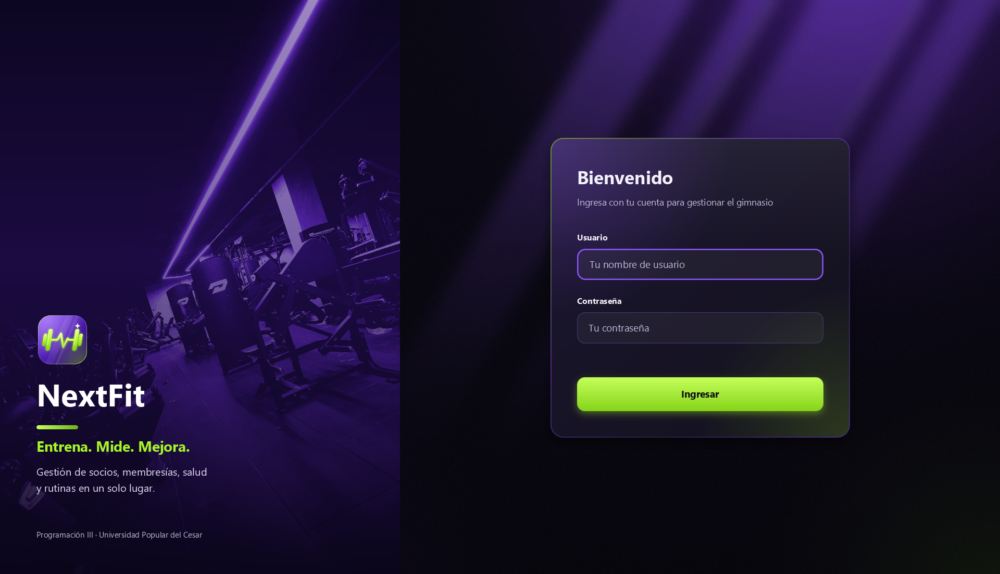 | 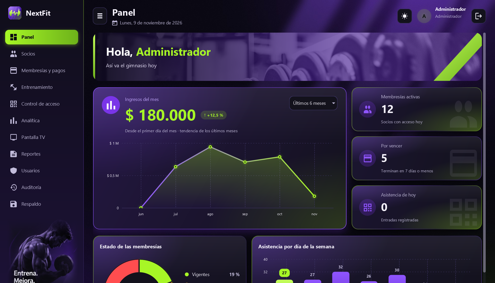 |

| Dashboard (light) | Dashboard charts |
|:--:|:--:|
| 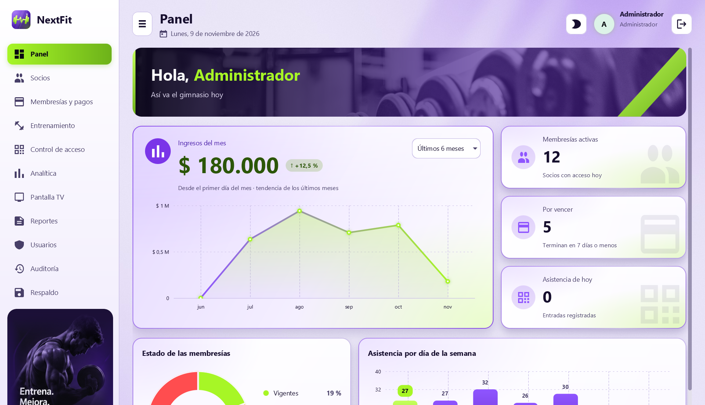 | 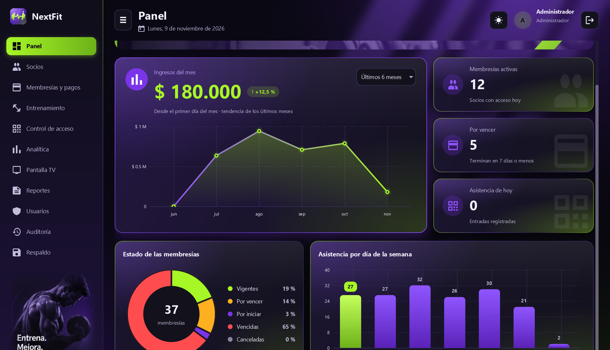 |

| Members | Billing |
|:--:|:--:|
| 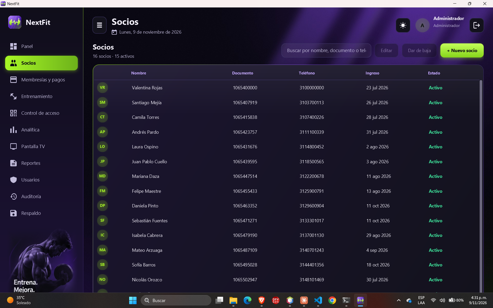 | 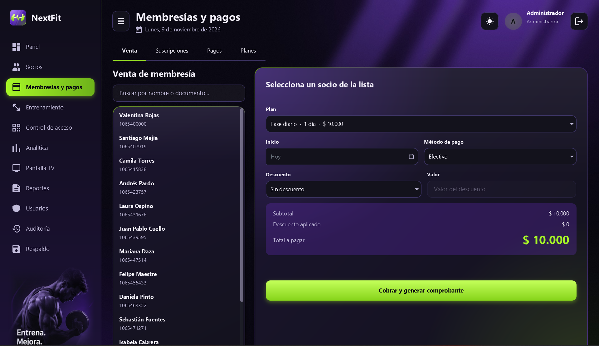 |

| Training | Access control |
|:--:|:--:|
| 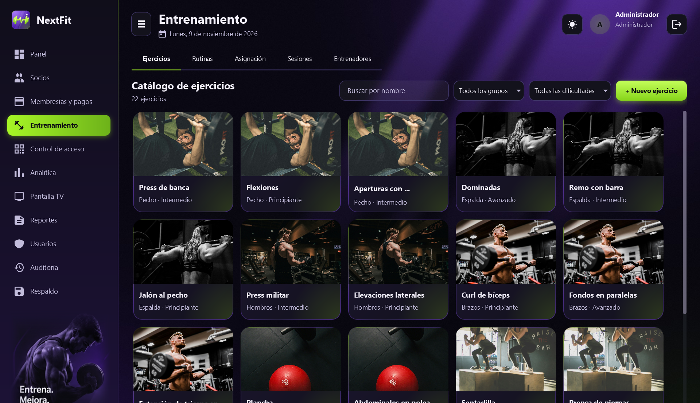 | 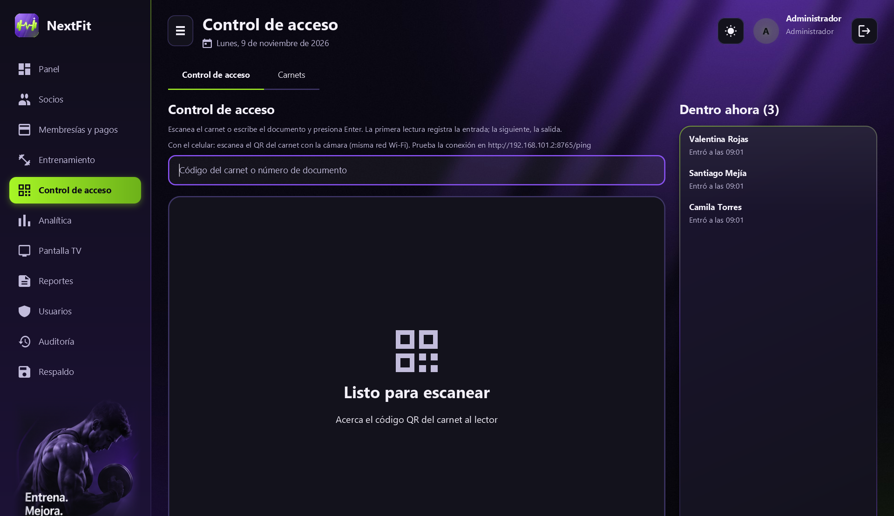 |

| Analytics | TV screen |
|:--:|:--:|
| 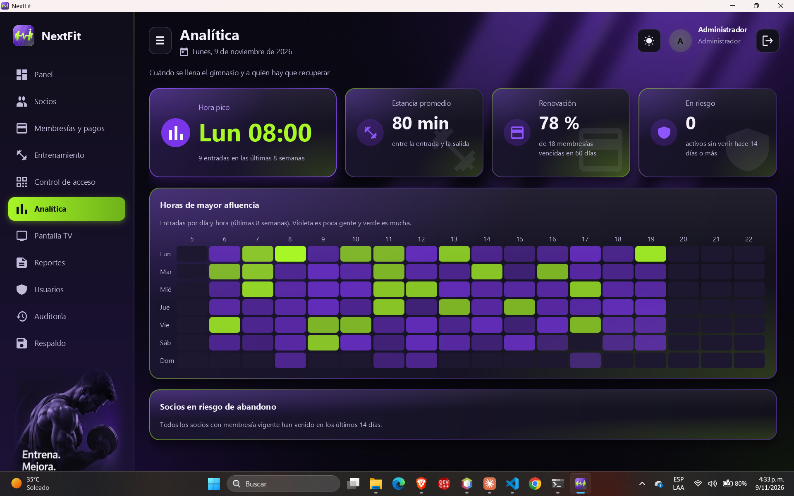 | 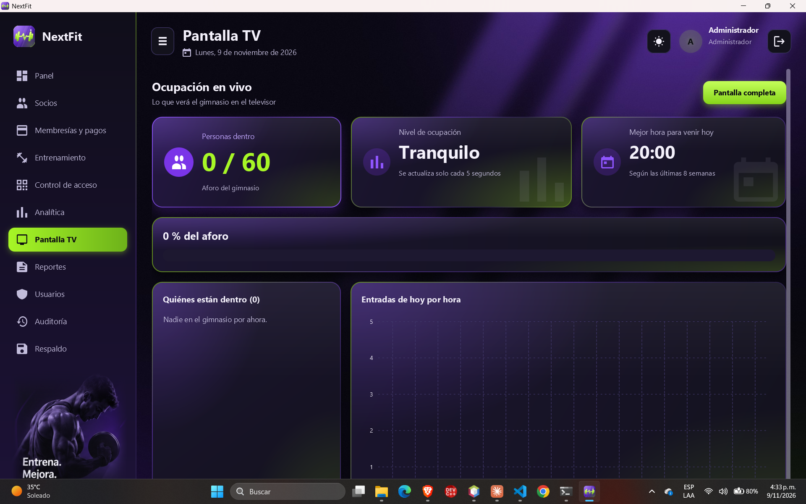 |

| Reports | Cash close |
|:--:|:--:|
| 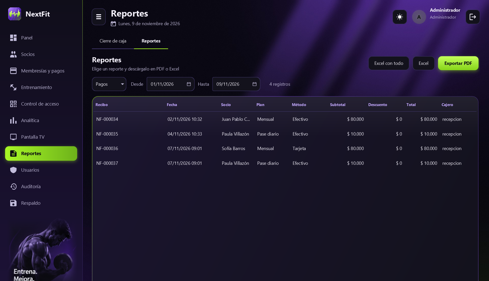 | 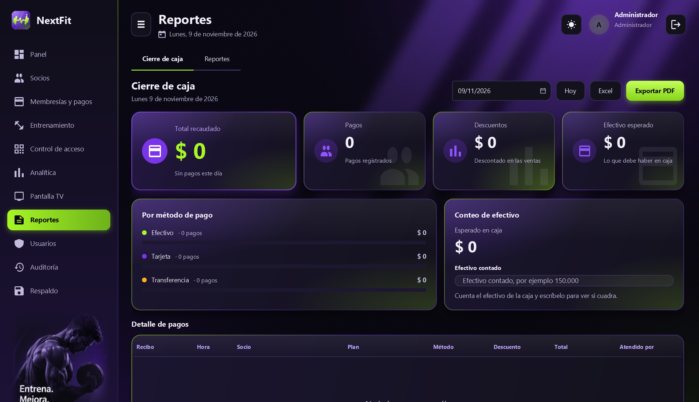 |

| Users | Audit log |
|:--:|:--:|
| 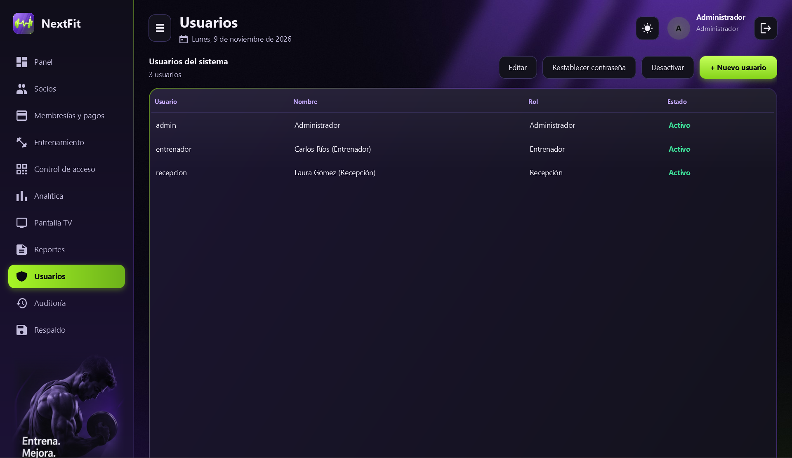 | 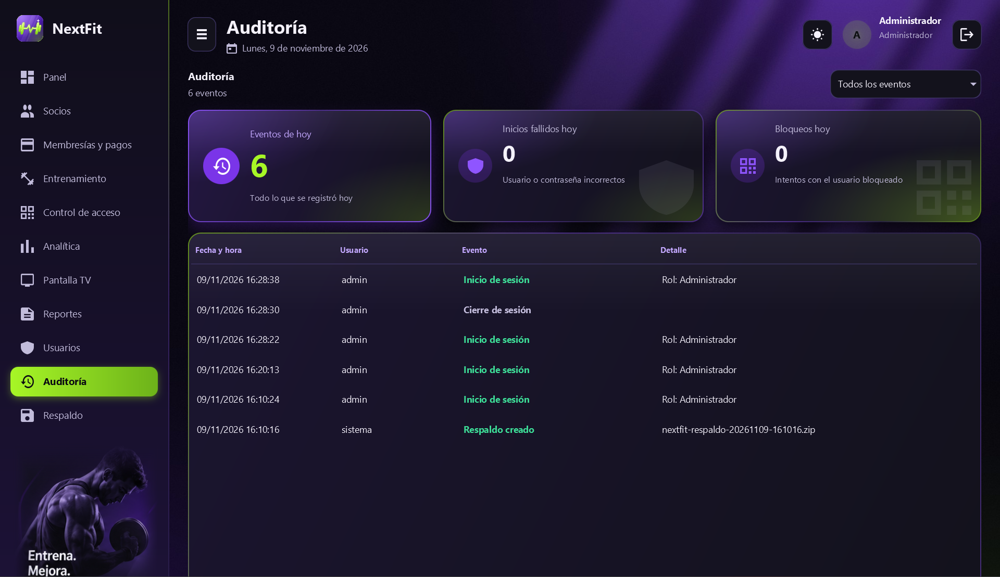 |

| Backup | Collapsed menu |
|:--:|:--:|
| 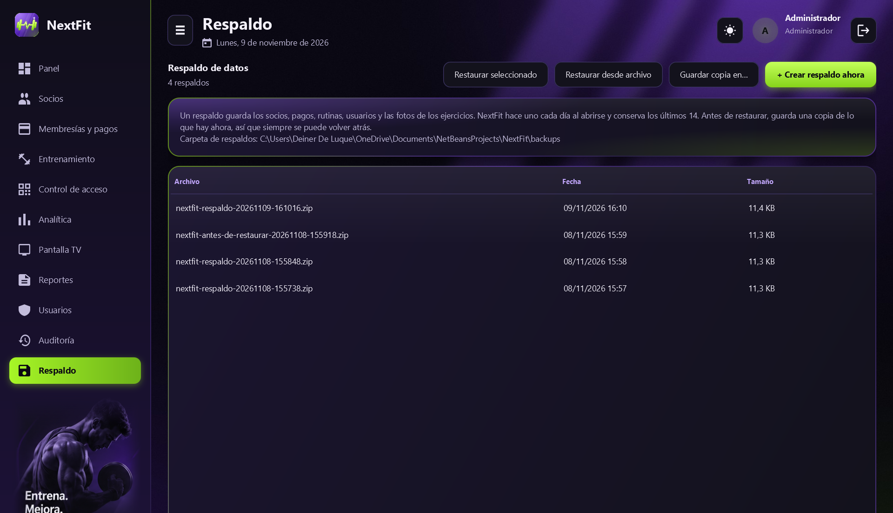 | 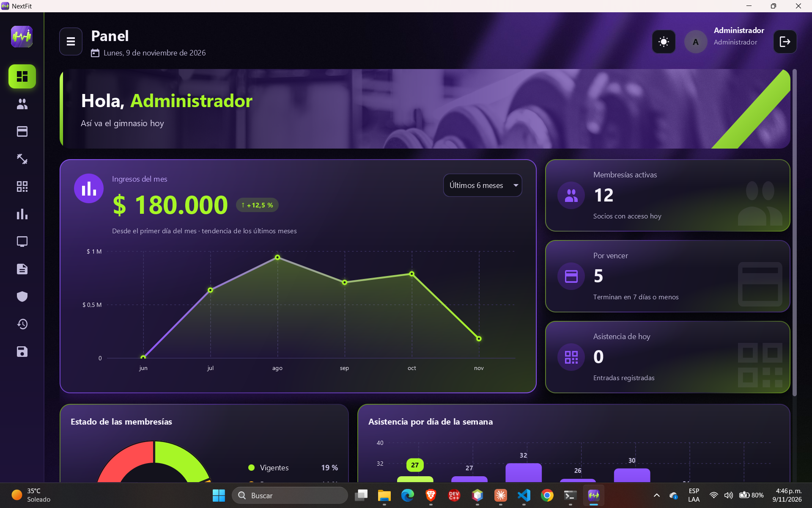 |

---

## Roles and permissions

The sidebar only shows the modules that the logged-in role can use.

| Module | Administrator | Reception | Trainer |
|---|:--:|:--:|:--:|
| Dashboard | ✅ | ✅ | ❌ |
| Members | ✅ edit | ✅ edit | 👁️ read only |
| Billing (plans, sales, payments) | ✅ | ✅ | ❌ |
| Training (exercises, routines, assignments) | ✅ | ❌ | ✅ |
| Access control (kiosk, carnets) | ✅ | ✅ | ❌ |
| Analytics | ✅ | ✅ | ❌ |
| Alerts | ✅ | ✅ | ❌ |
| TV screen | ✅ | ✅ | ❌ |
| Reports and cash close | ✅ | ✅ | ❌ |
| Users | ✅ | ❌ | ❌ |
| Audit log | ✅ | ❌ | ❌ |
| Backup | ✅ | ❌ | ❌ |

---

## Technologies

| Technology | Use |
|---|---|
| **Java 21** | Language (records, `java.time`) |
| **Maven** | Build, dependencies and tests |
| **JavaFX 21** | Desktop user interface |
| **AtlantaFX** | Base theme of the JavaFX controls, extended with the NextFit violet and lime design (`nextfit.css`, `nextfit-violet.css`) |
| **ZXing** | QR codes of the carnets |
| **JDK `HttpServer`** | Small web server for the phone access |
| **CSV files** | Persistence (no database yet) |
| **Own PDF and Excel writers** | Reports, with no extra dependency (`PdfExporter`, `XlsxWriter`) |
| **JUnit 5** | Unit testing |
| **GitHub Actions** | Build and tests on every pull request |
| **Git / GitHub** | Version control, feature branches and pull requests |

> The first version of the interface was written with Swing; it was replaced by JavaFX and removed from the code (it stays in the `v0.7-swing` tag).

---

## Architecture

NextFit is organized in layers. Each layer only depends on the ones below it, and the domain (`model`) depends on nothing.

```text
┌──────────────────────────────────────────────┐
│  UI  (ui, ui.members, ui.billing, ...)       │  JavaFX screens
└───────────────────────┬──────────────────────┘
                        ▼
┌──────────────────────────────────────────────┐
│  SERVICE + VALIDATION                        │  business rules
└───────────────────────┬──────────────────────┘
                        ▼
┌──────────────────────────────────────────────┐
│  PERSISTENCE  (repositories + CSV)           │  interfaces and CSV implementations
└───────────────────────┬──────────────────────┘
                        ▼
┌──────────────────────────────────────────────┐
│  MODEL  (domain)                             │  entities, enums
└──────────────────────────────────────────────┘
        exceptions · util  →  cross-cutting
```

Key design decisions:

- **Repositories behind interfaces**: services depend on `MemberRepository`, not on CSV. Replacing the CSV files by a database later only means adding new implementations.
- **Dependency injection by constructor** with a composition root (`Main`), so every class is easy to test with fakes.
- **Immutable model**: entities are never modified in place; `withX(...)` methods return a modified copy.
- **Injected `Clock`**: services receive a `java.time.Clock`, which makes date-dependent rules testable.
- **Computed state**: the status of a subscription is calculated from its dates, never stored.
- **Modules as plugins of the window**: every JavaFX screen implements `FxModule` (id, title, icon, view and which roles can open it) and `ShellView` builds the menu from them, so a new module appears without changing the window. The composition root (`Main`) lists them.
- **Rules as plugins**: alerts are `AlertRule` objects and training suggestions are `SuggestionRule` objects; a new rule is a new class, not a change in the service.
- **Security behind interfaces**: `AttemptLimiter` and `AuditLog` are interfaces, so the in-memory limiter and the CSV audit can be replaced later.
- **Money as whole pesos** (`long`), avoiding floating point errors.

The full diagrams (Mermaid) are in:

- 📦 [Package diagram by layers](docs/layers-diagram.md)
- 🧩 [Domain class diagram](docs/domain-class-diagram.md)
- 🗺️ [Integrated class diagram](docs/integrated-class-diagram.md)

### Domain model (summary)

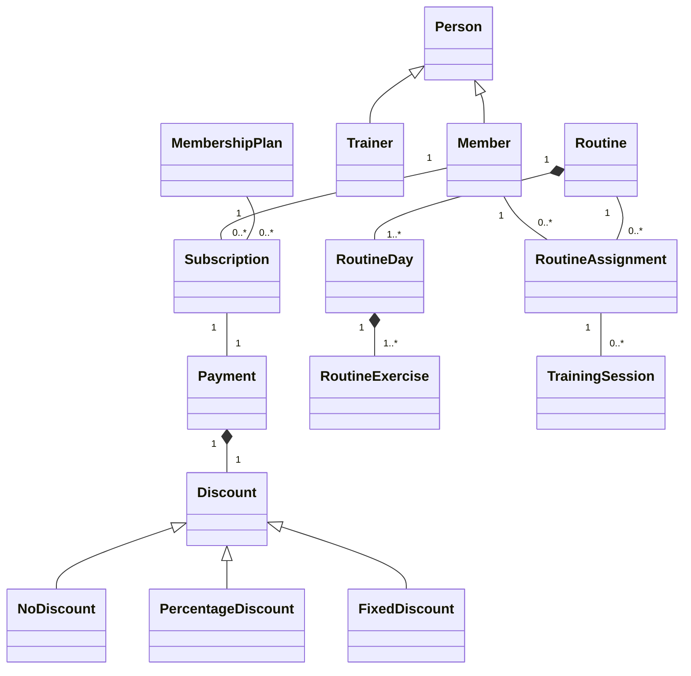

---

## Project structure

```text
NextFit/
├── pom.xml
├── README.md
├── .github/workflows/             # CI: build and tests
├── data/                          # CSV files, access key and pictures (created on first run)
├── backups/                       # automatic and manual backups (git-ignored)
├── docs/
│   ├── user-manual.md             # how to use every screen
│   ├── ui-design.md               # design system and how to build a screen
│   ├── audit-and-security.md
│   ├── backup-restore.md
│   ├── reports-cash-close.md
│   ├── phone-qr-access.md
│   ├── layers-diagram.md
│   ├── domain-class-diagram.md
│   ├── integrated-class-diagram.md
│   ├── principles-traceability.md # GRASP / SOLID per member
│   ├── image-credits.md
│   └── screenshots/
└── src/
    ├── main/
    │   ├── java/com/nextfit/
    │   │   ├── Main.java          # composition root
    │   │   ├── TrainingModule.java
    │   │   ├── DemoData.java      # demo data seeder
    │   │   ├── exceptions/        # typed exception hierarchy
    │   │   ├── model/             # domain entities and enums
    │   │   ├── persistence/       # repository interfaces + CSV implementations
    │   │   ├── service/           # business logic
    │   │   │   ├── alert/         #   alerts engine
    │   │   │   ├── audit/         #   audit log
    │   │   │   ├── occupancy/     #   live occupation (TV screen)
    │   │   │   ├── security/      #   login lockout and inactivity
    │   │   │   └── suggest/       #   routine suggestions
    │   │   ├── validation/        # one validator per area
    │   │   ├── export/            # PDF and Excel writers
    │   │   ├── web/               # phone access server
    │   │   ├── util/              # PasswordHasher, PhotoStorage
    │   │   └── ui/
    │   │       ├── fx/            # JavaFX interface
    │   │       ├── billing/       # ReceiptText, shared by the receipts
    │   │       └── Formats.java   # how pesos and dates are written and read
    │   └── resources/
    │       ├── fx/                # nextfit.css and nextfit-violet.css
    │       └── images/            # logo, backgrounds, banners, login, exercises
    └── test/java/com/nextfit/     # JUnit tests
```

---

## Getting started

### Requirements

- **JDK 21** or newer
- **Maven 3.9** or newer (or the Maven integrated in NetBeans / IntelliJ)

Check your versions:

```bash
java -version
mvn -version
```

### Clone

```bash
git clone https://github.com/Deliner2501/NextFit.git
cd NextFit
```

### Run

From the terminal:

```bash
mvn clean compile exec:java
```

Or from the IDE: open the project as a Maven project and run the class `com.nextfit.Main`.

> The application must be started from the project root, because the `data/` and `backups/` folders are created relative to the working directory.

### Build a package

```bash
mvn clean package
```

### Sign in

On the first run the system creates the following users:

| Role | Username | Password |
|---|---|---|
| Administrator | `admin` | `admin123` |
| Reception | `recepcion` | `recepcion123` |
| Trainer | `entrenador` | `entrenador123` |

> Change these passwords from the **Users** module before using the system in a real environment.

---

## Demo data

To make the application look alive from the very first run, `DemoData` fills an empty installation with realistic data: membership plans, trainers, members with health history, subscriptions and payments spread over previous months, attendance records, the exercise catalog, routines, assignments and training sessions. As a result the dashboard shows meaningful numbers right away.

- It runs automatically at startup, **only when the installation is empty** (no members, plans, trainers or exercises). It never overwrites existing data.
- To start again from scratch, close the application and delete the `data/` folder.

---

## Data storage

Everything is stored as plain CSV files inside `data/`:

| File | Content |
|---|---|
| `users.csv` | System users (password hashes) |
| `members.csv` | Members |
| `health_profiles.csv` | Health profile of each member |
| `measurements.csv` | Body measurements history |
| `attendance.csv` | Check-ins and check-outs |
| `plans.csv` | Membership plans |
| `subscriptions.csv` | Memberships bought by members |
| `payments.csv` | Payments and receipts |
| `trainers.csv` | Trainers |
| `exercises.csv` | Exercise catalog |
| `routines.csv`, `routine_lines.csv` | Routines, their days and exercises |
| `assignments.csv` | Routines assigned to members |
| `training_sessions.csv` | Training sessions log |
| `audit.csv` | Audit log (who did what and when) |
| `access.key` | Secret key of the carnet QR codes (never committed; deleting it invalidates the printed carnets) |
| `images/exercises/` | Pictures of the exercises |
| `photos/` | Photos uploaded for members and trainers |

Backups of this folder are kept in `backups/` (see [`docs/backup-restore.md`](docs/backup-restore.md)).

Relations between entities are stored as identifiers (for example a subscription keeps the `memberId` and the `planId`). A shared `CsvStore` handles reading and writing, and one `CsvMapper` per entity converts between rows and objects.

---

## Business rules

Some of the rules enforced by the services (all of them covered by tests):

- A member can only buy a membership if they are **active** and the plan is still **available**.
- A subscription that already expired **cannot be cancelled**, and a cancelled one cannot be cancelled again.
- A **routine can only be assigned** to a member with a **valid membership**; the trainer of the routine must be active.
- Only an **active assignment** can be completed, cancelled or used for a training session, and it must belong to the member.
- A training session must refer to a **day that exists** in the routine.
- A member cannot check in twice without checking out, nor check out without an open entry. Inactive members cannot check in.
- Usernames are unique; you cannot deactivate your own user, and at least one active administrator must remain.
- Plan names are unique.
- After 5 failed sign-ins a user is blocked for 5 minutes, and a session with no activity for 15 minutes is closed; both are written in the audit log.
- A carnet code is not the document: it is an HMAC of it with a secret key, and the same code read twice in 10 seconds is counted once.
- Restoring a backup first saves the current data, and refuses any zip that is not a NextFit backup or that has paths leaving the data folder.
- Data validation, for example: age between 12 and 100 years, document between 5 and 12 digits, phone between 7 and 15 digits, height between 100 and 250 cm, weight between 20 and 400 kg, valid blood types only.

---

## Testing

```bash
mvn test
```

The suite covers services (members, health, attendance, access, plans, subscriptions, payments, cash close, reports, analytics, occupancy, alerts, audit, security, exercises, routine assignments, training sessions, users, dashboard, backup), the phone access server and page, the PDF and Excel writers, the demo data seeder, formatting and receipt helpers, photo storage and UI helper components. The tests run on every pull request through GitHub Actions. Services are tested with in-memory fake repositories, so the tests need no files and run fast.

---

## Design principles (GRASP and SOLID)

The team keeps a traceability table that links every principle with the exact class and the commit where it was applied: see [`docs/principles-traceability.md`](docs/principles-traceability.md).

Some examples:

| Principle | Where |
|---|---|
| **Single Responsibility** | One service and one validator per functional area; one mapper per entity |
| **Open/Closed** | `Discount` hierarchy: a new discount type is a new subclass |
| **Liskov Substitution** | `Member` and `Trainer` can be used wherever a `Person` is expected |
| **Interface Segregation** | `SubscriptionChecker` exposes only what other services need from subscriptions |
| **Dependency Inversion** | Services depend on repository interfaces; implementations are injected from `Main` |
| **Information Expert** | `Subscription` computes its own status and days left |
| **Creator / Controller** | `Main` composes the application; services coordinate each use case |
| **Polymorphism** | `Discount.amountOff` and `Person.getPersonType` |
| **Low coupling / High cohesion** | Layers with one-way dependencies (see the package diagram) |

---

## Documentation

| Document | Description |
|---|---|
| [User manual](docs/user-manual.md) | How to use every screen, by role |
| [UI design guide](docs/ui-design.md) | Colors, depth, motion and how to build a new screen |
| [Audit log and security](docs/audit-and-security.md) | Lockout, inactivity and what is recorded |
| [Backup and restore](docs/backup-restore.md) | How the backups work and how to recover the data |
| [Reports and cash close](docs/reports-cash-close.md) | The cash close and the PDF and Excel reports |
| [Phone QR access](docs/phone-qr-access.md) | Entry with the phone camera |
| [Layers diagram](docs/layers-diagram.md) | Package diagram by layers |
| [Domain class diagram](docs/domain-class-diagram.md) | Business classes, inheritance and relations |
| [Integrated class diagram](docs/integrated-class-diagram.md) | All the classes, split by module |
| [Principles traceability](docs/principles-traceability.md) | GRASP / SOLID applied per member and commit |
| [Image credits](docs/image-credits.md) | Authors and sources of the photos |

---

## Team

| Member | Role | GitHub |
|---|---|---|
| **Deiner De Luque** | Technical Lead | [@Deliner2501](https://github.com/Deliner2501) |
| **Ronald Mendoza** | Developer | [@rymendoza](https://github.com/rymendoza) |
| **Santiago Meza** | Developer | [@smmeza](https://github.com/smmeza) |

**Course:** Programación III · **University:** Universidad Popular del Cesar

### Workflow

- Work is done in **feature branches** (`feature/...`) that are merged into `develop` through **pull requests**; branches are not deleted after merging.
- Commits follow **Conventional Commits** (`feat`, `fix`, `docs`, `test`, `refactor`).
- Code, comments and documentation are written in **English**; the user interface is in **Spanish**.

---

## Credits

- Photos from [Unsplash](https://unsplash.com) and [Pexels](https://www.pexels.com); the authors are listed in [`docs/image-credits.md`](docs/image-credits.md).
- UI controls by [JavaFX](https://openjfx.io) and the [AtlantaFX](https://github.com/mkpaz/atlantafx) theme.

---

<div align="center">

Made with 💪 by the NextFit team · 2026

</div>
