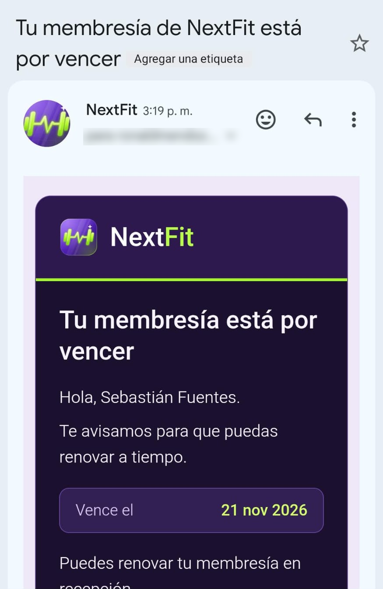

# Automatic email

NextFit can send payment receipts and membership expiration reminders through Gmail. Email is off unless explicitly configured. It runs in the background while the desktop app is open and connected to the internet.

Both notifications display NextFit as the sender name and include the embedded NextFit logo in the violet and lime email design. Each message also includes a plain-text version for clients that do not display HTML.

## Configure the desktop app once

Create `nextfit-email.properties` beside `pom.xml`, using a dedicated Gmail account with two-step verification and an app password:

```properties
email.mode=test
email.account=your-nextfit-account@gmail.com
email.testRecipient=your-test-inbox@example.com
email.password=YOUR_APP_PASSWORD
```

The app password is stored as readable text on this workstation. Keep this file private. It is ignored by Git. Run the project from NetBeans as usual. Use `email.mode=off` to disable email.

## Test with your own inbox

Start with `email.mode=test`. Test mode sends only to the configured test inbox and prefixes each subject with `[PRUEBA]`. Use demo data when possible.

For a temporary run, environment variables override the corresponding file entries:

```powershell
$env:NEXTFIT_EMAIL_MODE = 'test'
$env:NEXTFIT_EMAIL_ACCOUNT = 'your-nextfit-account@gmail.com'
$env:NEXTFIT_EMAIL_TO = 'your-test-inbox@example.com'
$env:NEXTFIT_EMAIL_PASSWORD = Read-Host 'Gmail app password' -MaskInput
```

Launch NextFit from that shell with `mvn clean compile exec:java`. An IDE already open will not inherit temporary environment settings.

With NextFit open, register a new membership payment. The worker checks about every two minutes. To test a reminder, use an active membership that expires within the next three days and has no consecutive renewal. Old payments from before the first activation of the mode are excluded.

## Live mode and delivery records

After checking both messages, set `email.mode=live` and reopen NextFit. Live mode uses the email saved on the member record. It has a separate activation date and history from test mode. Without a valid email address, the record is skipped.

Each notification has a file in `data/email/test` or `data/email/live`. A file claims the notification before sending, so later scans and restarts do not send it again. `PENDING` means the attempt started or was interrupted, `SENT` means Gmail accepted it, and `FAILED` indicates a transport error. Gmail acceptance does not guarantee inbox delivery. Failed or interrupted attempts are not automatically retried because an interrupted connection may occur after Gmail accepts the email. Check Gmail's sent folder before manually following up.

Reminders can be sent on the expiration day if NextFit was closed during its three-day window. A reminder is skipped after the membership expires. The worker attempts at most ten sends per scan.

To retry a failed receipt, open **Membresías y pagos → Pagos**, select the payment and choose **Reintentar correo**. Confirm only after checking the sender's Sent folder. The retry uses the current test or live mode and preserves the original payment and its delivery history. Receipts marked as sent or pending are ineligible for retry.

The **Correo** column in **Pagos** reads the current mode's history and refreshes automatically. **Enviado** means Gmail accepted the message, **Fallido** means the transport returned an error, **Pendiente** means an attempt started without a recorded outcome, and **Sin intento** means there is no delivery record in that mode.

## Example

A membership reminder as the member sees it in Gmail:

<p align="center"></p>
