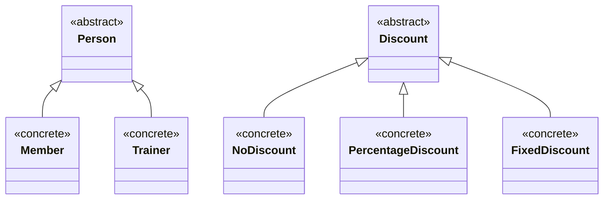
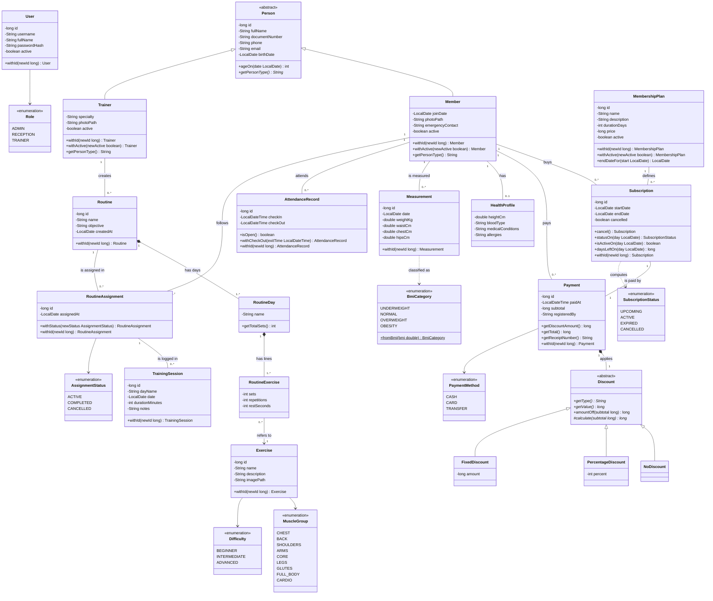

# Domain Class Diagram

This diagram contains only the business classes of NextFit (package `model`): what the gym works with, with its inheritance and its relations. Persistence, services and screens are in the [integrated class diagram](integrated-class-diagram.md).

Conventions: getters are omitted; `withX(...)` methods return a modified copy because the classes are immutable; associations between entities are stored as identifiers (for example `Subscription.memberId`), so they are drawn as associations with their multiplicity.

## Hierarchies

## Domain model

