# Entity-relationship model (MER)

NextFit keeps its data in an Oracle Autonomous Database (Always Free). The base schema has **18 tables**,
created from `src/main/resources/db/schema.sql` by `OracleSchemaInstaller`. Installing
`docs/sql/plsql-extras.sql` adds `payment_db_log`, bringing the total to **19 application tables**.
The data of the CSV files is copied with `CsvToOracleMigration`.
The columns, types and checks of every table are in the [data dictionary](data-dictionary.md).

## Diagram

```mermaid
erDiagram
    members ||--o{ subscriptions : "buys"
    membership_plans ||--o{ subscriptions : "is bought as"
    subscriptions ||--o{ payments : "is paid by"
    members ||--o{ payments : "makes"
    members ||--o{ attendance : "comes in"
    members ||--o| health_profiles : "has"
    members ||--o{ measurements : "is measured in"
    members ||--o{ face_templates : "has faces"
    members ||--o| member_credentials : "has a password"
    trainers |o--o{ routines : "creates"
    routines ||--o{ routine_lines : "has"
    exercises ||--o{ routine_lines : "is used in"
    members ||--o{ assignments : "receives"
    routines ||--o{ assignments : "is given in"
    members ||--o{ training_sessions : "does"
    assignments ||--o{ training_sessions : "is done in"
    users {
        NUMBER id PK
        VARCHAR2 username UK
        VARCHAR2 full_name
        VARCHAR2 password_hash
        VARCHAR2 role
        NUMBER active
    }
    members {
        NUMBER id PK
        VARCHAR2 full_name
        VARCHAR2 document_number UK
        VARCHAR2 phone
        VARCHAR2 email
        DATE birth_date
        DATE join_date
        VARCHAR2 photo_path
        VARCHAR2 emergency_contact
        NUMBER active
    }
    membership_plans {
        NUMBER id PK
        VARCHAR2 name
        VARCHAR2 description
        NUMBER duration_days
        NUMBER price
        NUMBER active
    }
    subscriptions {
        NUMBER id PK
        NUMBER member_id FK
        NUMBER plan_id FK
        DATE start_date
        DATE end_date
        NUMBER cancelled
    }
    payments {
        NUMBER id PK
        NUMBER subscription_id FK
        NUMBER member_id FK
        TIMESTAMP paid_at
        VARCHAR2 method
        NUMBER subtotal
        VARCHAR2 discount_type
        NUMBER discount_value
        VARCHAR2 registered_by
    }
    attendance {
        NUMBER id PK
        NUMBER member_id FK
        TIMESTAMP check_in
        TIMESTAMP check_out
    }
    health_profiles {
        NUMBER member_id PK, FK
        NUMBER height_cm
        VARCHAR2 blood_type
        VARCHAR2 medical_conditions
        VARCHAR2 allergies
    }
    measurements {
        NUMBER id PK
        NUMBER member_id FK
        DATE measured_on
        NUMBER weight_kg
        NUMBER waist_cm
        NUMBER chest_cm
        NUMBER hips_cm
    }
    exercises {
        NUMBER id PK
        VARCHAR2 name
        VARCHAR2 description
        VARCHAR2 muscle_group
        VARCHAR2 difficulty
        VARCHAR2 image_path
    }
    trainers {
        NUMBER id PK
        VARCHAR2 full_name
        VARCHAR2 document_number UK
        VARCHAR2 phone
        VARCHAR2 email
        DATE birth_date
        VARCHAR2 specialty
        VARCHAR2 photo_path
        NUMBER active
    }
    routines {
        NUMBER id PK
        VARCHAR2 name
        VARCHAR2 objective
        NUMBER trainer_id FK
        DATE created_at
    }
    routine_lines {
        NUMBER routine_id PK, FK
        NUMBER day_index PK
        NUMBER line_no PK
        VARCHAR2 day_name
        NUMBER exercise_id FK
        NUMBER sets
        NUMBER repetitions
        NUMBER rest_seconds
    }
    assignments {
        NUMBER id PK
        NUMBER member_id FK
        NUMBER routine_id FK
        DATE assigned_at
        VARCHAR2 status
    }
    training_sessions {
        NUMBER id PK
        NUMBER member_id FK
        NUMBER assignment_id FK
        VARCHAR2 day_name
        DATE session_date
        NUMBER duration_minutes
        VARCHAR2 notes
    }
    audit_log {
        NUMBER id PK
        TIMESTAMP event_time
        VARCHAR2 username
        VARCHAR2 action
        VARCHAR2 detail
    }
    face_templates {
        NUMBER id PK
        NUMBER member_id FK
        VARCHAR2 embedding
        TIMESTAMP created_at
    }
    member_credentials {
        NUMBER member_id PK, FK
        VARCHAR2 password_hash
    }
    access_settings {
        NUMBER id PK
        BLOB access_key
    }
    payment_db_log {
        NUMBER id PK
        NUMBER payment_id
        NUMBER member_id
        NUMBER subtotal
        TIMESTAMP logged_at
        VARCHAR2 db_user
    }
```

Keys: `PK` primary key, `FK` foreign key, `UK` unique. `routine_lines` has a primary key of three columns.
`users` and `audit_log` have no relationships on purpose: the audit log keeps the user name as text, so it
does not depend on the `users` table.

`access_settings` holds the shared carnet signing key in one row and has no foreign keys.
`payment_db_log` is added by the PL/SQL extras script. Its `payment_id` and `member_id` columns
record the identifiers copied by `trg_payments_log`; the script declares no foreign keys on them,
so they are shown without FK relationships. The view `v_active_members` is a query over existing
tables and is excluded from the table count.

## Relationships

| One | Many | Side of the many | Meaning |
|---|---|---|---|
| `members` | `subscriptions` | many (0..N) | buys |
| `membership_plans` | `subscriptions` | many (0..N) | is bought as |
| `subscriptions` | `payments` | many (0..N) | is paid by |
| `members` | `payments` | many (0..N) | makes |
| `members` | `attendance` | many (0..N) | comes in |
| `members` | `health_profiles` | optional (0..1) | has |
| `members` | `measurements` | many (0..N) | is measured in |
| `members` | `face_templates` | many (0..N) | has faces |
| `members` | `member_credentials` | optional (0..1) | has a password |
| `trainers` | `routines` | many (0..N) | creates |
| `routines` | `routine_lines` | many (0..N) | has |
| `exercises` | `routine_lines` | many (0..N) | is used in |
| `members` | `assignments` | many (0..N) | receives |
| `routines` | `assignments` | many (0..N) | is given in |
| `members` | `training_sessions` | many (0..N) | does |
| `assignments` | `training_sessions` | many (0..N) | is done in |

Deleting a member also deletes his `face_templates` and his `member_credentials` (`ON DELETE CASCADE`).
In the other tables a member is never deleted, only deactivated (`active = 0`), so the history of
subscriptions, payments and attendance is kept.

## Design decisions

- **CSV data:** the 17 data tables follow the existing CSV formats, including `routine_lines` for
  routine exercises. `access_settings` stores the shared key, and `payment_db_log` records payments
  through a database trigger.
- **Identifiers:** `NUMBER(19)` identity columns that also accept a given value, so the migration keeps the
  identifiers of the CSV files and the repositories can still ask the database for a new one.
  The supporting table `payment_db_log` uses `GENERATED ALWAYS AS IDENTITY`; `access_settings`
  instead uses a fixed identifier of 1 enforced by a check constraint.
- **Enumerations** (role, payment method, muscle group, status...) are stored by the **name** of the Java
  constant, never by its label, so a label can change without touching the data.
- **Money** is `NUMBER(12,2)` in whole Colombian pesos. The total of a payment is calculated, not stored.
- **Booleans** are `NUMBER(1)` with a check (`0` or `1`).
- **Empty texts:** Oracle stores an empty text as NULL, so the optional text columns accept NULL and the
  repositories turn NULL back into an empty text when they read.
- **Sensitive data:** only hashes are stored for passwords (`users`, `member_credentials`), and the face is
  a vector of numbers (`face_templates`), never a photo.
- **Indexes** on the columns used to find the rows of a member: `idx_subscriptions_member`,
  `idx_payments_member`, `idx_attendance_member`, `idx_measurements_member`, `idx_assignments_member`,
  `idx_sessions_member` and `idx_face_templates_member`.
