<!-- Generated by docs/tools/generate_docs.py from the source code. Do not edit by hand: run the script again. -->

# Integrated Class Diagram

All the classes of the system, split by module so each diagram can be read. They come from the source code: a hollow triangle is inheritance (solid line) or interface implementation (dotted line), and an arrow means that the class keeps the other one in an attribute. Every class and its role is in the [class catalog](class-catalog.md); attributes and methods are in the [class reference](class-reference.md). A diagram shows up to five attributes and five methods per class.

## Domain model

32 classes.

```mermaid
classDiagram
    direction TB
    class AssignmentStatus {
        <<enumeration>>
        COMPLETED
        CANCELLED
        -String label
    }
    class AttendanceRecord {
        -long id
        -long memberId
        -LocalDateTime checkIn
        -LocalDateTime checkOut
        +withId()
        +withCheckOut()
    }
    class AuditAction {
        <<enumeration>>
        LOGIN
        LOGIN_FAILED
        LOCKOUT
        LOGOUT
        SESSION_EXPIRED
        USER_CREATED
        USER_UPDATED
        PASSWORD_RESET
        -String label
    }
    class AuditEntry {
        -long id
        -LocalDateTime timestamp
        -String username
        -AuditAction action
        -String detail
        +withId()
    }
    class BmiCategory {
        <<enumeration>>
        UNDERWEIGHT
        NORMAL
        OVERWEIGHT
        OBESITY
        -String label
        +fromBmi()
    }
    class Difficulty {
        <<enumeration>>
        INTERMEDIATE
        ADVANCED
        -String label
    }
    class Discount {
        <<abstract>>
        +amountOff()
    }
    class Exercise {
        -long id
        -String name
        -String description
        -MuscleGroup muscleGroup
        -Difficulty difficulty
        +withId()
    }
    class FaceTemplate {
        -long memberId
        -float[] vector
        +vector()
    }
    class FixedDiscount {
        -long amount
    }
    class HealthProfile {
        -long memberId
        -double heightCm
        -String bloodType
        -String medicalConditions
        -String allergies
    }
    class Measurement {
        -long id
        -long memberId
        -LocalDate date
        -double weightKg
        -double waistCm
        +withId()
    }
    class Member {
        -LocalDate joinDate
        -String photoPath
        -String emergencyContact
        -boolean active
        +withId()
        +withActive()
    }
    class MemberCredential {
        -long memberId
        -String passwordHash
    }
    class MembershipPlan {
        -long id
        -String name
        -String description
        -int durationDays
        -long price
        +withId()
        +withActive()
        +endDateFor()
    }
    class MuscleGroup {
        <<enumeration>>
        -String label
    }
    class NoDiscount {
    }
    class Payment {
        -long id
        -long subscriptionId
        -long memberId
        -LocalDateTime paidAt
        -PaymentMethod method
        +withId()
    }
    class PaymentMethod {
        <<enumeration>>
        CASH
        CARD
        TRANSFER
        -String label
    }
    class PercentageDiscount {
        -int percent
    }
    class Person {
        <<abstract>>
        -long id
        -String fullName
        -String documentNumber
        -String phone
        -String email
        +ageOn()
    }
    class Role {
        <<enumeration>>
        ADMIN
        RECEPTION
        TRAINER
        -String label
    }
    class Routine {
        -long id
        -String name
        -String objective
        -long trainerId
        -LocalDate createdAt
        +withId()
    }
    class RoutineAssignment {
        -long id
        -long memberId
        -long routineId
        -LocalDate assignedAt
        -AssignmentStatus status
        +withId()
        +withStatus()
    }
    class RoutineDay {
        -String name
        -List~RoutineExercise~ exercises
    }
    class RoutineExercise {
        -long exerciseId
        -int sets
        -int repetitions
        -int restSeconds
    }
    class Subscription {
        -long id
        -long memberId
        -long planId
        -LocalDate startDate
        -LocalDate endDate
        +withId()
        +cancel()
        +statusOn()
        +daysLeftOn()
    }
    class SubscriptionStatus {
        <<enumeration>>
        UPCOMING
        ACTIVE
        EXPIRED
        CANCELLED
        -String label
    }
    class Trainer {
        -String specialty
        -String photoPath
        -boolean active
        +withId()
        +withActive()
    }
    class TrainingGoal {
        <<enumeration>>
        WEIGHT_LOSS
        TONING
        -String label
        -int sets
        -int repetitions
        -int restSeconds
        -boolean cardioEveryDay
        +requiresCardioEveryDay()
    }
    class TrainingSession {
        -long id
        -long memberId
        -long assignmentId
        -String dayName
        -LocalDate date
        +withId()
    }
    class User {
        -long id
        -String username
        -String fullName
        -String passwordHash
        -Role role
        +withId()
    }
    AuditEntry --> AuditAction
    Exercise --> MuscleGroup
    Exercise --> Difficulty
    Discount <|-- FixedDiscount
    Person <|-- Member
    Discount <|-- NoDiscount
    Payment --> PaymentMethod
    Payment --> Discount
    Discount <|-- PercentageDiscount
    Routine --> RoutineDay
    RoutineAssignment --> AssignmentStatus
    RoutineDay --> RoutineExercise
    Person <|-- Trainer
    User --> Role
```

## Persistence: contracts and CSV

51 classes.

```mermaid
classDiagram
    direction TB
    class AccessKeyStore {
        +loadOrCreate()
        +cache()
    }
    class AssignmentCsvMapper {
        +toRow()
        +fromRow()
    }
    class AssignmentRepository {
        <<interface>>
        +findAll()
        +findById()
        +findByMemberId()
        +save()
    }
    class AttendanceCsvMapper {
        +toRow()
        +fromRow()
    }
    class AttendanceRepository {
        <<interface>>
        +findAll()
        +findByMemberId()
        +findOpenByMemberId()
        +save()
    }
    class AuditCsvMapper {
        +toRow()
        +fromRow()
    }
    class AuditRepository {
        <<interface>>
        +findAll()
        +append()
    }
    class CsvAssignmentRepository {
        -CsvStore store
        +findAll()
        +findById()
        +findByMemberId()
        +save()
    }
    class CsvAttendanceRepository {
        -CsvStore store
        +findAll()
        +findByMemberId()
        +findOpenByMemberId()
        +save()
    }
    class CsvAuditRepository {
        -CsvStore store
        +findAll()
        +append()
    }
    class CsvExerciseRepository {
        -CsvStore store
        +findAll()
        +findById()
        +findByName()
        +save()
    }
    class CsvFaceTemplateRepository {
        -CsvStore store
        +findAll()
        +replace()
        +delete()
    }
    class CsvHealthProfileRepository {
        -CsvStore store
        +findByMemberId()
        +save()
    }
    class CsvMeasurementRepository {
        -CsvStore store
        +findByMemberId()
        +save()
    }
    class CsvMemberCredentialRepository {
        -CsvStore store
        +find()
        +save()
        +delete()
    }
    class CsvMemberRepository {
        -CsvStore store
        +findAll()
        +findById()
        +findByDocumentNumber()
        +save()
    }
    class CsvMembershipPlanRepository {
        -CsvStore store
        +findAll()
        +findById()
        +findByName()
        +save()
    }
    class CsvPaymentRepository {
        -CsvStore store
        +findAll()
        +findById()
        +findByMemberId()
        +save()
    }
    class CsvRoutineRepository {
        -CsvStore routineStore
        -CsvStore lineStore
        +findAll()
        +findById()
        +findByTrainerId()
        +save()
    }
    class CsvSnapshot {
        +write()
    }
    class CsvStorage {
        -UserRepository users
        -MemberRepository members
        -HealthProfileRepository healthProfiles
        -MeasurementRepository measurements
        -MembershipPlanRepository plans
        +users()
        +members()
        +healthProfiles()
        +measurements()
        +plans()
    }
    class CsvStore {
        -Path file
        -String[] columns
        +readAll()
        +writeAll()
    }
    class CsvSubscriptionRepository {
        -CsvStore store
        +findAll()
        +findById()
        +findByMemberId()
        +save()
    }
    class CsvTrainerRepository {
        -CsvStore store
        +findAll()
        +findById()
        +findByDocumentNumber()
        +save()
    }
    class CsvTrainingSessionRepository {
        -CsvStore store
        +findAll()
        +findById()
        +findByMemberId()
        +save()
    }
    class CsvUserRepository {
        -CsvStore store
        +findAll()
        +findById()
        +findByUsername()
        +save()
    }
    class ExerciseCsvMapper {
        +toRow()
        +fromRow()
    }
    class ExerciseRepository {
        <<interface>>
        +findAll()
        +findById()
        +findByName()
        +save()
    }
    class FaceTemplateRepository {
        <<interface>>
        +findAll()
        +replace()
        +delete()
        +has()
    }
    class HealthProfileCsvMapper {
        +toRow()
        +fromRow()
    }
    class HealthProfileRepository {
        <<interface>>
        +findByMemberId()
        +save()
    }
    class MeasurementCsvMapper {
        +toRow()
        +fromRow()
    }
    class MeasurementRepository {
        <<interface>>
        +findByMemberId()
        +save()
    }
    class MemberCredentialRepository {
        <<interface>>
        +find()
        +save()
        +delete()
    }
    class MemberCsvMapper {
        +toRow()
        +fromRow()
    }
    class MemberRepository {
        <<interface>>
        +findAll()
        +findById()
        +findByDocumentNumber()
        +save()
    }
    class MembershipPlanCsvMapper {
        +toRow()
        +fromRow()
    }
    class MembershipPlanRepository {
        <<interface>>
        +findAll()
        +findById()
        +findByName()
        +save()
    }
    class PaymentCsvMapper {
        +toRow()
        +fromRow()
    }
    class PaymentRepository {
        <<interface>>
        +findAll()
        +findById()
        +findByMemberId()
        +save()
    }
    class RoutineCsvMapper {
        +toRoutineRow()
        +toLineRows()
        +fromRows()
    }
    class RoutineRepository {
        <<interface>>
        +findAll()
        +findById()
        +findByTrainerId()
        +save()
    }
    class Storage {
        <<interface>>
        +users()
        +members()
        +healthProfiles()
        +measurements()
        +plans()
    }
    class SubscriptionCsvMapper {
        +toRow()
        +fromRow()
    }
    class SubscriptionRepository {
        <<interface>>
        +findAll()
        +findById()
        +findByMemberId()
        +save()
    }
    class TrainerCsvMapper {
        +toRow()
        +fromRow()
    }
    class TrainerRepository {
        <<interface>>
        +findAll()
        +findById()
        +findByDocumentNumber()
        +save()
    }
    class TrainingSessionCsvMapper {
        +toRow()
        +fromRow()
    }
    class TrainingSessionRepository {
        <<interface>>
        +findAll()
        +findById()
        +findByMemberId()
        +save()
    }
    class UserCsvMapper {
        +toRow()
        +fromRow()
    }
    class UserRepository {
        <<interface>>
        +findAll()
        +findById()
        +findByUsername()
        +save()
    }
    AssignmentRepository <|.. CsvAssignmentRepository
    CsvAssignmentRepository --> CsvStore
    AttendanceRepository <|.. CsvAttendanceRepository
    CsvAttendanceRepository --> CsvStore
    AuditRepository <|.. CsvAuditRepository
    CsvAuditRepository --> CsvStore
    ExerciseRepository <|.. CsvExerciseRepository
    CsvExerciseRepository --> CsvStore
    FaceTemplateRepository <|.. CsvFaceTemplateRepository
    CsvFaceTemplateRepository --> CsvStore
    HealthProfileRepository <|.. CsvHealthProfileRepository
    CsvHealthProfileRepository --> CsvStore
    MeasurementRepository <|.. CsvMeasurementRepository
    CsvMeasurementRepository --> CsvStore
    MemberCredentialRepository <|.. CsvMemberCredentialRepository
    CsvMemberCredentialRepository --> CsvStore
    MemberRepository <|.. CsvMemberRepository
    CsvMemberRepository --> CsvStore
    MembershipPlanRepository <|.. CsvMembershipPlanRepository
    CsvMembershipPlanRepository --> CsvStore
    PaymentRepository <|.. CsvPaymentRepository
    CsvPaymentRepository --> CsvStore
    RoutineRepository <|.. CsvRoutineRepository
    CsvRoutineRepository --> CsvStore
    Storage <|.. CsvStorage
    CsvStorage --> UserRepository
    CsvStorage --> MemberRepository
    CsvStorage --> HealthProfileRepository
    CsvStorage --> MeasurementRepository
    CsvStorage --> MembershipPlanRepository
    CsvStorage --> SubscriptionRepository
    CsvStorage --> PaymentRepository
    CsvStorage --> AttendanceRepository
    CsvStorage --> FaceTemplateRepository
    CsvStorage --> MemberCredentialRepository
    CsvStorage --> AuditRepository
    CsvStorage --> TrainerRepository
    CsvStorage --> ExerciseRepository
    CsvStorage --> RoutineRepository
    CsvStorage --> AssignmentRepository
    CsvStorage --> TrainingSessionRepository
    SubscriptionRepository <|.. CsvSubscriptionRepository
    CsvSubscriptionRepository --> CsvStore
    TrainerRepository <|.. CsvTrainerRepository
    CsvTrainerRepository --> CsvStore
    TrainingSessionRepository <|.. CsvTrainingSessionRepository
    CsvTrainingSessionRepository --> CsvStore
    UserRepository <|.. CsvUserRepository
    CsvUserRepository --> CsvStore
```

## Persistence: Oracle (JDBC)

30 classes.

```mermaid
classDiagram
    direction TB
    class ConnectionSource {
        <<interface>>
        +open()
    }
    class CsvToOracleMigration {
        +main()
    }
    class DataMigration {
        -Storage source
        -Storage target
        +run()
        +count()
    }
    class DatabaseConfig {
        -String url
        -String user
        -String password
        +load()
        +toString()
    }
    class JdbcAccessKeyStore {
        -ConnectionSource connections
    }
    class JdbcAssignmentRepository {
        -ConnectionSource connections
        +findAll()
        +findById()
        +findByMemberId()
        +save()
    }
    class JdbcAttendanceRepository {
        -ConnectionSource connections
        +findAll()
        +findByMemberId()
        +findOpenByMemberId()
        +save()
    }
    class JdbcAuditRepository {
        -ConnectionSource connections
        +findAll()
        +append()
    }
    class JdbcCsvBackup {
    }
    class JdbcExerciseRepository {
        -ConnectionSource connections
        +findAll()
        +findById()
        +findByName()
        +save()
    }
    class JdbcFaceTemplateRepository {
        -ConnectionSource connections
        +findAll()
        +has()
        +replace()
        +delete()
    }
    class JdbcHealthProfileRepository {
        -ConnectionSource connections
        +findByMemberId()
        +save()
    }
    class JdbcMeasurementRepository {
        -ConnectionSource connections
        +findByMemberId()
        +save()
    }
    class JdbcMemberCredentialRepository {
        -ConnectionSource connections
        +find()
        +save()
        +delete()
    }
    class JdbcMemberRepository {
        -ConnectionSource connections
        +findAll()
        +findById()
        +findByDocumentNumber()
        +save()
    }
    class JdbcMemberRepositoryCheck {
        +main()
    }
    class JdbcMembershipPlanRepository {
        -ConnectionSource connections
        +findAll()
        +findById()
        +findByName()
        +save()
    }
    class JdbcPaymentRepository {
        -ConnectionSource connections
        +findAll()
        +findById()
        +findByMemberId()
        +save()
    }
    class JdbcRepositoriesCheck {
        +main()
    }
    class JdbcRoutineRepository {
        -ConnectionSource connections
        +findAll()
        +findById()
        +findByTrainerId()
        +save()
    }
    class JdbcStorage {
        -ConnectionSource connections
        -JdbcAccessKeyStore accessKeys
        -UserRepository users
        -MemberRepository members
        -HealthProfileRepository healthProfiles
        +users()
        +members()
        +healthProfiles()
        +measurements()
        +plans()
    }
    class JdbcSubscriptionRepository {
        -ConnectionSource connections
        +findAll()
        +findById()
        +findByMemberId()
        +save()
    }
    class JdbcSupport {
    }
    class JdbcTrainerRepository {
        -ConnectionSource connections
        +findAll()
        +findById()
        +findByDocumentNumber()
        +save()
    }
    class JdbcTrainingSessionRepository {
        -ConnectionSource connections
        +findAll()
        +findById()
        +findByMemberId()
        +save()
    }
    class JdbcUserRepository {
        -ConnectionSource connections
        +findAll()
        +findById()
        +findByUsername()
        +save()
    }
    class OracleConnectionCheck {
        +main()
    }
    class OracleConnectionProvider {
        -DatabaseConfig config
        +open()
    }
    class OracleSchemaInstaller {
        +main()
    }
    class PooledConnectionSource {
        -ConnectionSource source
        -BlockingQueue~Connection~ idle
        -Semaphore permits
        +open()
    }
    JdbcAccessKeyStore --> ConnectionSource
    class AssignmentRepository {
        <<interface>>
    }
    AssignmentRepository <|.. JdbcAssignmentRepository
    JdbcAssignmentRepository --> ConnectionSource
    class AttendanceRepository {
        <<interface>>
    }
    AttendanceRepository <|.. JdbcAttendanceRepository
    JdbcAttendanceRepository --> ConnectionSource
    class AuditRepository {
        <<interface>>
    }
    AuditRepository <|.. JdbcAuditRepository
    JdbcAuditRepository --> ConnectionSource
    class ExerciseRepository {
        <<interface>>
    }
    ExerciseRepository <|.. JdbcExerciseRepository
    JdbcExerciseRepository --> ConnectionSource
    class FaceTemplateRepository {
        <<interface>>
    }
    FaceTemplateRepository <|.. JdbcFaceTemplateRepository
    JdbcFaceTemplateRepository --> ConnectionSource
    class HealthProfileRepository {
        <<interface>>
    }
    HealthProfileRepository <|.. JdbcHealthProfileRepository
    JdbcHealthProfileRepository --> ConnectionSource
    class MeasurementRepository {
        <<interface>>
    }
    MeasurementRepository <|.. JdbcMeasurementRepository
    JdbcMeasurementRepository --> ConnectionSource
    class MemberCredentialRepository {
        <<interface>>
    }
    MemberCredentialRepository <|.. JdbcMemberCredentialRepository
    JdbcMemberCredentialRepository --> ConnectionSource
    class MemberRepository {
        <<interface>>
    }
    MemberRepository <|.. JdbcMemberRepository
    JdbcMemberRepository --> ConnectionSource
    class MembershipPlanRepository {
        <<interface>>
    }
    MembershipPlanRepository <|.. JdbcMembershipPlanRepository
    JdbcMembershipPlanRepository --> ConnectionSource
    class PaymentRepository {
        <<interface>>
    }
    PaymentRepository <|.. JdbcPaymentRepository
    JdbcPaymentRepository --> ConnectionSource
    class RoutineRepository {
        <<interface>>
    }
    RoutineRepository <|.. JdbcRoutineRepository
    JdbcRoutineRepository --> ConnectionSource
    class Storage {
        <<interface>>
    }
    Storage <|.. JdbcStorage
    JdbcStorage --> ConnectionSource
    JdbcStorage --> JdbcAccessKeyStore
    JdbcStorage --> MemberRepository
    JdbcStorage --> HealthProfileRepository
    JdbcStorage --> MeasurementRepository
    JdbcStorage --> MembershipPlanRepository
    JdbcStorage --> PaymentRepository
    JdbcStorage --> AttendanceRepository
    JdbcStorage --> FaceTemplateRepository
    JdbcStorage --> MemberCredentialRepository
    JdbcStorage --> AuditRepository
    JdbcStorage --> ExerciseRepository
    JdbcStorage --> RoutineRepository
    JdbcStorage --> AssignmentRepository
    class SubscriptionRepository {
        <<interface>>
    }
    SubscriptionRepository <|.. JdbcSubscriptionRepository
    JdbcSubscriptionRepository --> ConnectionSource
    class TrainerRepository {
        <<interface>>
    }
    TrainerRepository <|.. JdbcTrainerRepository
    JdbcTrainerRepository --> ConnectionSource
    class TrainingSessionRepository {
        <<interface>>
    }
    TrainingSessionRepository <|.. JdbcTrainingSessionRepository
    JdbcTrainingSessionRepository --> ConnectionSource
    class UserRepository {
        <<interface>>
    }
    UserRepository <|.. JdbcUserRepository
    JdbcUserRepository --> ConnectionSource
    ConnectionSource <|.. OracleConnectionProvider
    OracleConnectionProvider --> DatabaseConfig
    ConnectionSource <|.. PooledConnectionSource
```

## Business services

34 classes.

```mermaid
classDiagram
    direction TB
    class AccessResult {
        -Outcome outcome
        -Member member
        -String message
        -LocalDate validUntil
        -long daysLeft
        +granted()
    }
    class AccessService {
        -MemberService memberService
        -AttendanceService attendanceService
        -MembershipExpiry expiry
        -Clock clock
        -List~Consumer~AccessResult~~ listeners
        +addListener()
        +process()
        +processMember()
        +deny()
    }
    class AccessTokens {
        -byte[] secret
        +tokenFor()
        +matches()
        +normalize()
    }
    class AnalyticsService {
        -AttendanceService attendance
        -SubscriptionService subscriptions
        -Clock clock
        +report()
    }
    class AttendanceService {
        -MemberService memberService
        -AttendanceRepository attendance
        -SubscriptionChecker subscriptionChecker
        -Clock clock
        +checkIn()
        +checkOut()
        +findInside()
        +findAll()
        +findByMember()
    }
    class AuthService {
        -UserRepository users
        -AttemptLimiter limiter
        -AuditLog audit
        +ensureDefaultAdmin()
        +login()
        +logout()
        +expire()
    }
    class BackupInfo {
        -Path file
        -LocalDateTime createdAt
        -long size
        +name()
    }
    class BackupService {
        -Path dataDir
        -Path backupDir
        -Clock clock
        -AuditLog audit
        -Supplier~String~ actor
        +canRestore()
        +backupDir()
        +createBackup()
        +backupIfNoneToday()
        +list()
    }
    class CarnetCode {
        +encode()
        +decode()
    }
    class CashClose {
        -LocalDate day
        -List~Line~ lines
        -Map~PaymentMethod, Long~ byMethod
        -long total
        -long discounts
        +count()
        +expectedCash()
        +difference()
        +withCountedCash()
    }
    class CashCloseService {
        -PaymentService payments
        -MemberService members
        +closeOf()
        +linesBetween()
    }
    class ColumnType {
        <<enumeration>>
    }
    class DashboardService {
        -SubscriptionService subscriptions
        -PaymentService payments
        -AttendanceService attendance
        -Clock clock
        +changePercent()
        +summary()
    }
    class ExerciseService {
        -ExerciseRepository exercises
        -ExerciseValidator validator
        +findAll()
        +findById()
        +search()
        +create()
        +update()
    }
    class HealthService {
        -MemberService memberService
        -HealthProfileRepository profiles
        -MeasurementRepository measurements
        -HealthValidator validator
        +calculateBmi()
        +classify()
        +saveProfile()
        +findProfile()
        +addMeasurement()
    }
    class MemberPasswordService {
        -MemberCredentialRepository credentials
        -AttemptLimiter limiter
        -AuditLog audit
        +create()
        +reset()
        +matches()
    }
    class MemberService {
        -MemberRepository members
        -MemberValidator validator
        +findAll()
        +findById()
        +findByDocumentNumber()
        +search()
        +register()
    }
    class MembershipExpiry {
        <<interface>>
        +validUntil()
    }
    class MembershipPlanService {
        -MembershipPlanRepository plans
        -MembershipPlanValidator validator
        +findAll()
        +findActive()
        +findById()
        +create()
        +update()
    }
    class MembershipSale {
        -Subscription subscription
        -Payment payment
        -MembershipPlan plan
    }
    class OccupancyHeatmap {
        -long[][] counts
        +of()
        +count()
        +max()
        +total()
        +peak()
    }
    class PaymentService {
        -PaymentRepository payments
        -SubscriptionService subscriptions
        -MembershipPlanService plans
        -PaymentValidator validator
        -Clock clock
        +sellMembership()
        +findById()
        +findSale()
        +findAll()
        +findByMember()
    }
    class PhoneAccess {
        -MemberService memberService
        -AccessTokens tokens
        +tokenOf()
        +findMember()
    }
    class ReportService {
        -CashCloseService cashClose
        -MemberService members
        -SubscriptionService subscriptions
        -AttendanceService attendance
        +payments()
        +cashCloseSheets()
        +members()
        +attendance()
    }
    class ReportTable {
        -String title
        -List~String~ headers
        -List~ColumnType~ types
        -List~List~Object~~ rows
    }
    class RoutineAssignmentService {
        -AssignmentRepository assignments
        -MemberService members
        -RoutineService routines
        -SubscriptionChecker subscriptions
        +findCurrentFor()
        +findHistoryFor()
        +findById()
        +assign()
        +complete()
    }
    class RoutineService {
        -RoutineRepository routines
        -RoutineValidator validator
        -TrainerService trainers
        -ExerciseService exercises
        +findAll()
        +findById()
        +findByTrainer()
        +create()
        +update()
    }
    class SelfAccessService {
        -Function~String, Optional~Member~~ findByDocument
        -MemberPasswordService passwords
        -AttemptLimiter limiter
        -AuditLog audit
        -Function~Member, AccessResult~ admit
        +enter()
    }
    class Session {
        -User currentUser
        +start()
        +end()
    }
    class SubscriptionChecker {
        <<interface>>
    }
    class SubscriptionService {
        -SubscriptionRepository subscriptions
        -MembershipPlanService plans
        -MemberService members
        -Clock clock
        +subscribe()
        +findCurrentFor()
        +findAll()
        +statusOf()
        +daysLeftOf()
    }
    class TrainerService {
        -TrainerRepository trainers
        -TrainerValidator validator
        +findAll()
        +findById()
        +register()
        +update()
        +deactivate()
    }
    class TrainingSessionService {
        -TrainingSessionRepository sessions
        -TrainingSessionValidator validator
        -RoutineAssignmentService assignments
        -RoutineService routines
        -SubscriptionChecker subscriptions
        +findByMember()
        +log()
    }
    class UserService {
        -UserRepository users
        -UserValidator validator
        -AuditLog audit
        -Supplier~String~ actor
        +findAll()
        +create()
        +update()
        +resetPassword()
        +deactivate()
    }
    AccessService --> MemberService
    AccessService --> AttendanceService
    AccessService --> MembershipExpiry
    AnalyticsService --> AttendanceService
    AnalyticsService --> SubscriptionService
    AttendanceService --> MemberService
    AttendanceService --> SubscriptionChecker
    CashCloseService --> PaymentService
    CashCloseService --> MemberService
    DashboardService --> SubscriptionService
    DashboardService --> PaymentService
    DashboardService --> AttendanceService
    HealthService --> MemberService
    PaymentService --> SubscriptionService
    PaymentService --> MembershipPlanService
    PhoneAccess --> MemberService
    PhoneAccess --> AccessTokens
    ReportService --> CashCloseService
    ReportService --> MemberService
    ReportService --> SubscriptionService
    ReportService --> AttendanceService
    ReportTable --> ColumnType
    RoutineAssignmentService --> MemberService
    RoutineAssignmentService --> RoutineService
    RoutineAssignmentService --> SubscriptionChecker
    RoutineService --> TrainerService
    RoutineService --> ExerciseService
    SelfAccessService --> MemberPasswordService
    SelfAccessService --> AccessResult
    SubscriptionChecker <|.. SubscriptionService
    SubscriptionService --> MembershipPlanService
    SubscriptionService --> MemberService
    TrainingSessionService --> RoutineAssignmentService
    TrainingSessionService --> RoutineService
    TrainingSessionService --> SubscriptionChecker
```

## Alerts, churn risk and suggestions

28 classes.

```mermaid
classDiagram
    direction TB
    class Alert {
        -AlertType type
        -Member member
        -long days
        -LocalDate date
    }
    class AlertMessages {
        -String gymName
        +textFor()
    }
    class AlertRule {
        <<interface>>
        +evaluate()
    }
    class AlertService {
        -List~AlertRule~ rules
        -Clock clock
        +withStandardRules()
        +findAll()
        +findByType()
        +count()
        +countByType()
    }
    class AlertType {
        <<enumeration>>
        -String label
    }
    class BirthdayRule {
        -MemberService members
        -int daysAhead
        +evaluate()
    }
    class BmiRule {
        +apply()
    }
    class ChurnFactor {
        -int points
        -String reason
    }
    class ChurnRisk {
        -Member member
        -int score
        -RiskLevel level
        -List~String~ reasons
        +action()
        +detail()
    }
    class ChurnRule {
        <<interface>>
        +assess()
    }
    class ChurnService {
        -AttendanceService attendance
        -SubscriptionService subscriptions
        -MemberService members
        -List~ChurnRule~ rules
        -Clock clock
        +withStandardRules()
        +findAll()
        +findAtLeast()
        +findFor()
        +countByLevel()
    }
    class DaysAwayRule {
        -int maxPoints
        -int freeDays
        -int fullDays
        +assess()
    }
    class ExpiringMembershipRule {
        -SubscriptionService subscriptions
        -MemberService members
        -int days
        +evaluate()
    }
    class ExpiringSoonRule {
        -int maxPoints
        -int days
        +assess()
    }
    class FrequencyDropRule {
        -int maxPoints
        -int recentWeeks
        -int baselineWeeks
        +assess()
    }
    class InactiveMemberRule {
        -AttendanceService attendance
        -SubscriptionService subscriptions
        -MemberService members
        -int inactiveDays
        +evaluate()
    }
    class MedicalConditionRule {
        +apply()
    }
    class MemberActivity {
        -LocalDate today
        -List~LocalDate~ visitDays
        -LocalDate membershipStart
        -LocalDate membershipEnd
        -boolean renewed
        +visitsBetween()
        +lastVisit()
        +daysAway()
        +daysLeft()
    }
    class RiskLevel {
        <<enumeration>>
        LOW
        MEDIUM
        HIGH
        -String label
        -int fromScore
        -String action
        +of()
    }
    class RoutineDraft {
        -List~Day~ days
    }
    class RoutineDraftChecker {
        -Clock clock
        +check()
    }
    class SuggestedRoutine {
        -Routine routine
        -List~String~ notes
    }
    class SuggestionRequest {
        -TrainingGoal goal
        -Difficulty level
        -int daysPerWeek
        -BmiCategory bmiCategory
        -String medicalConditions
    }
    class SuggestionRule {
        <<interface>>
        +apply()
    }
    class SuggestionService {
        -ExerciseService exercises
        -HealthService health
        -List~SuggestionRule~ rules
        -Clock clock
        +requestFor()
        +suggest()
        +settingsFor()
    }
    class SuggestionSettings {
        -Difficulty maxLevel
        -int restSeconds
        -boolean cardioEveryDay
        -int exercisesPerDay
        -Map~MuscleGroup, Difficulty~ groupCaps
        +from()
        +allows()
        +withMaxLevelAtMost()
        +withRestAtLeast()
        +withCardioEveryDay()
    }
    class WeeklySplit {
        +forDays()
    }
    class WhatsAppLink {
        -String countryCode
        +forMessage()
    }
    Alert --> AlertType
    AlertService --> AlertRule
    AlertRule <|.. BirthdayRule
    SuggestionRule <|.. BmiRule
    ChurnRisk --> RiskLevel
    ChurnService --> ChurnRule
    ChurnRule <|.. DaysAwayRule
    AlertRule <|.. ExpiringMembershipRule
    ChurnRule <|.. ExpiringSoonRule
    ChurnRule <|.. FrequencyDropRule
    AlertRule <|.. InactiveMemberRule
    SuggestionRule <|.. MedicalConditionRule
    SuggestionService --> SuggestionRule
```

## Face recognition and camera

13 classes.

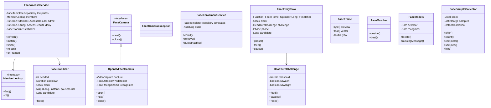

## Security, audit, occupancy, achievements and portal data

27 classes.

```mermaid
classDiagram
    direction TB
    class Achievements {
        -Member member
        -int trainingDays
        -Streak streak
        -List~Badge~ badges
    }
    class AttemptLimiter {
        <<interface>>
        +beforeAttempt()
        +failed()
        +succeeded()
    }
    class AuditLog {
        <<interface>>
        +record()
    }
    class AuditService {
        -AuditRepository repository
        -Clock clock
        +record()
        +findAll()
        +findByAction()
        +countToday()
    }
    class Badge {
        <<enumeration>>
        -String label
        -String description
        -Goal goal
        -int target
    }
    class BestTimesAdvisor {
        -OccupancyForecastService forecast
        -Clock clock
        +advise()
    }
    class GamificationService {
        -MemberService members
        -AttendanceService attendance
        -Clock clock
        +achievementsOf()
        +monthlyRanking()
        +monthlyRanking()
    }
    class HourForecast {
        -int hour
        -double expectedPeople
        -int percent
        -OccupancyLevel level
    }
    class InMemoryAttemptLimiter {
        -int maxAttempts
        -Duration lockTime
        -Clock clock
        -Map~String, State~ states
        +beforeAttempt()
        +failed()
        +succeeded()
    }
    class InactivityMonitor {
        -Duration limit
        -Clock clock
        -Instant lastActivity
        +touch()
    }
    class MemberPortal {
        -PhoneAccess phone
        -SubscriptionService subscriptions
        -MembershipPlanService plans
        -RoutineAssignmentService assignments
        -RoutineService routines
        +summaryFor()
        +summaryOf()
    }
    class OccupancyForecast {
        -LocalDate day
        -List~HourForecast~ hours
        -int daysOfHistory
        +bestHours()
        +busiest()
    }
    class OccupancyForecastService {
        -AttendanceService attendance
        -int capacity
        -Clock clock
        +forecastFor()
    }
    class OccupancyLevel {
        <<enumeration>>
        -String label
        -int fromPercent
        +of()
    }
    class OccupancyService {
        -AttendanceService attendance
        -MemberService members
        -int capacity
        -Clock clock
        -OccupancyForecastService forecasts
        +snapshot()
    }
    class OccupancySnapshot {
        -int inside
        -int capacity
        -int percent
        -OccupancyLevel level
        -List~Visitor~ visitors
    }
    class PortalBestTimes {
        -String dayLabel
        -List~HourForecast~ hours
    }
    class PortalExercise {
        -String name
        -String muscleGroup
        -int sets
        -int repetitions
        -int restSeconds
    }
    class PortalMembership {
        -String planName
        -LocalDate validUntil
        -long daysLeft
    }
    class PortalSummary {
        -Member member
        -Optional~PortalMembership~ membership
        -Optional~PortalWorkout~ workout
        -Achievements achievements
        -Optional~PortalBestTimes~ bestTimes
    }
    class PortalWorkout {
        -String routineName
        -String dayName
        -int dayNumber
        -int dayCount
        -List~PortalExercise~ exercises
    }
    class ProgressReport {
        -List~UpcomingDay~ upcoming
        -List~RecentVisit~ visits
        -Optional~BodyProgress~ body
    }
    class ProgressReportService {
        -RoutineAssignmentService assignments
        -RoutineService routines
        -TrainingSessionService sessions
        -AttendanceService attendance
        -HealthService health
        +of()
    }
    class RankingEntry {
        -int position
        -Member member
        -int days
    }
    class Streak {
        -int current
        -int best
    }
    class StreakCalculator {
        +calculate()
    }
    class WorkoutPlanner {
        +nextDayIndex()
    }
    Achievements --> Streak
    Achievements --> Badge
    AuditLog <|.. AuditService
    BestTimesAdvisor --> OccupancyForecastService
    HourForecast --> OccupancyLevel
    AttemptLimiter <|.. InMemoryAttemptLimiter
    MemberPortal --> GamificationService
    MemberPortal --> BestTimesAdvisor
    OccupancyForecast --> HourForecast
    OccupancyService --> OccupancyForecastService
    OccupancySnapshot --> OccupancyLevel
    OccupancySnapshot --> HourForecast
    PortalBestTimes --> HourForecast
    PortalSummary --> PortalMembership
    PortalSummary --> PortalWorkout
    PortalSummary --> Achievements
    PortalSummary --> PortalBestTimes
    PortalWorkout --> PortalExercise
```

## Validation, exceptions and helpers

17 classes.

```mermaid
classDiagram
    direction TB
    class AiException {
    }
    class BusinessRuleException {
    }
    class ExerciseValidator {
        +validate()
        +validateName()
        +validateDescription()
        +validateMuscleGroup()
        +validateDifficulty()
    }
    class HealthValidator {
        +validateProfile()
        +validateMeasurement()
    }
    class InvalidDataException {
        -String fieldName
    }
    class MemberValidator {
        +validate()
        +validateFullName()
        +validateDocumentNumber()
        +validatePhone()
        +validateEmail()
    }
    class MembershipPlanValidator {
        +validate()
        +validateName()
        +validateDescription()
        +validateDuration()
        +validatePrice()
    }
    class NextFitException {
        <<abstract>>
        -String errorCode
    }
    class PasswordHasher {
        +hash()
        +verify()
    }
    class PaymentValidator {
        +validateSale()
    }
    class PersistenceException {
    }
    class PhotoStorage {
        -Path directory
        +copy()
    }
    class ResourceNotFoundException {
    }
    class RoutineValidator {
        +validate()
        +validateName()
        +validateObjective()
        +validateTrainerId()
        +validateCreatedAt()
    }
    class TrainerValidator {
        +validate()
        +validateFullName()
        +validateDocumentNumber()
        +validatePhone()
        +validateEmail()
    }
    class TrainingSessionValidator {
        +validate()
        +validateIds()
        +validateDayName()
        +validateDate()
        +validateDuration()
    }
    class UserValidator {
        +validateNewUser()
        +validateUsername()
        +validateFullName()
        +validatePassword()
        +validateRole()
    }
    NextFitException <|-- AiException
    NextFitException <|-- BusinessRuleException
    NextFitException <|-- InvalidDataException
    NextFitException <|-- PersistenceException
    NextFitException <|-- ResourceNotFoundException
```

## AI assistant

28 classes.

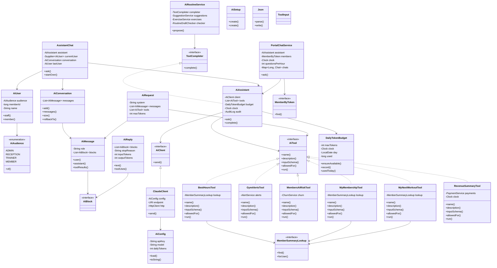

## Export and web server

12 classes.

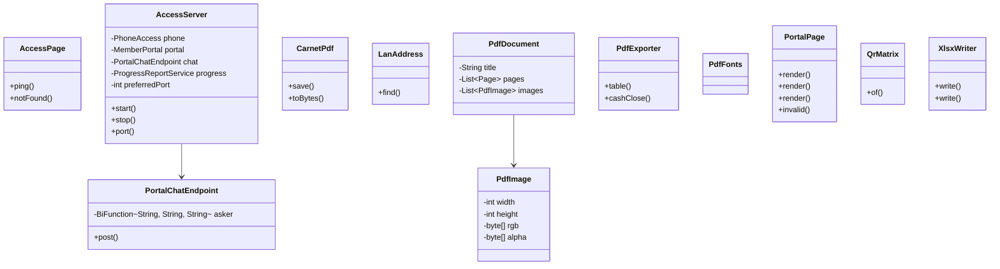

## Interface: window and modules

The package has 73 classes. The diagram shows the window and the 14 modules that implement `FxModule`; the panes, forms and helpers of each module are in the catalog.

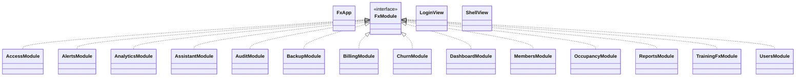

## Composition root

5 classes.

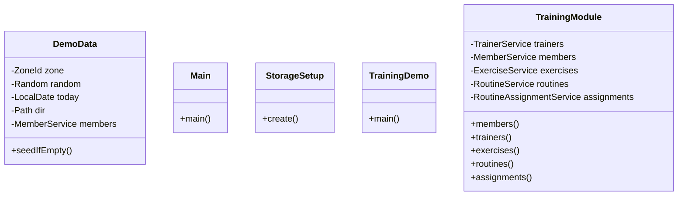

