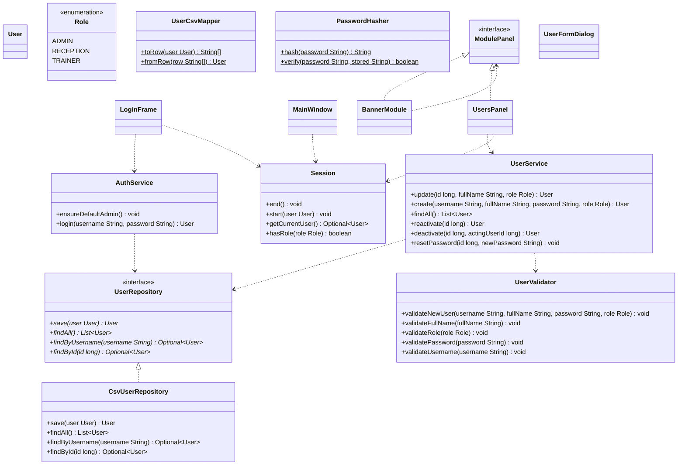
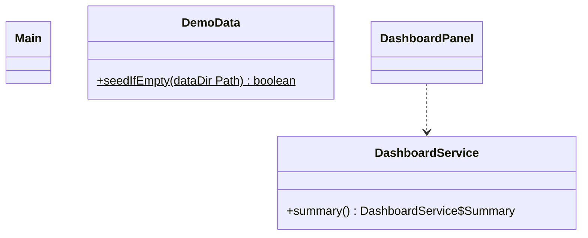

# Integrated Class Diagram

This is the complete class diagram of NextFit: domain, persistence, services, validation, screens and cross-cutting classes. It is split by module so every diagram stays readable. The pure business view (only `model`) is in the [domain class diagram](domain-class-diagram.md) and the package view is in the [layers diagram](layers-diagram.md).

Reading guide:

- `<|--` extends, `<|..` implements, `..>` uses (the class receives the other one in its constructor: dependency injection).
- Persistence: every `XRepository` interface has a `CsvXRepository` implementation, which uses an `XCsvMapper` and the shared `CsvStore`.
- Model classes are shown collapsed here; their attributes and relations are in the domain diagram.
- Screens are shown collapsed; each one receives the services it needs through its constructor.

## Access and users

## Members and health

```mermaid
classDiagram
    direction TB
    class Person {
        <<abstract>>
    }
    class Member {
    }
    class HealthProfile {
    }
    class Measurement {
    }
    class BmiCategory {
        <<enumeration>>
        UNDERWEIGHT
        NORMAL
        OVERWEIGHT
        OBESITY
    }
    class AttendanceRecord {
    }
    class MemberRepository {
        <<interface>>
        +save(member Member)* Member
        +findAll()* List~Member~
        +findById(id long)* Optional~Member~
        +findByDocumentNumber(documentNumber String)* Optional~Member~
    }
    class CsvMemberRepository {
        +save(member Member) Member
        +findAll() List~Member~
        +findById(id long) Optional~Member~
        +findByDocumentNumber(documentNumber String) Optional~Member~
    }
    class MemberCsvMapper {
        +toRow(member Member)$ String[]
        +fromRow(row String[])$ Member
    }
    class HealthProfileRepository {
        <<interface>>
        +save(profile HealthProfile)* HealthProfile
        +findByMemberId(memberId long)* Optional~HealthProfile~
    }
    class CsvHealthProfileRepository {
        +save(profile HealthProfile) HealthProfile
        +findByMemberId(memberId long) Optional~HealthProfile~
    }
    class HealthProfileCsvMapper {
        +toRow(profile HealthProfile)$ String[]
        +fromRow(row String[])$ HealthProfile
    }
    class MeasurementRepository {
        <<interface>>
        +save(measurement Measurement)* Measurement
        +findByMemberId(memberId long)* List~Measurement~
    }
    class CsvMeasurementRepository {
        +save(measurement Measurement) Measurement
        +findByMemberId(memberId long) List~Measurement~
    }
    class MeasurementCsvMapper {
        +toRow(measurement Measurement)$ String[]
        +fromRow(row String[])$ Measurement
    }
    class AttendanceRepository {
        <<interface>>
        +save(record AttendanceRecord)* AttendanceRecord
        +findAll()* List~AttendanceRecord~
        +findByMemberId(memberId long)* List~AttendanceRecord~
        +findOpenByMemberId(memberId long)* Optional~AttendanceRecord~
    }
    class CsvAttendanceRepository {
        +save(record AttendanceRecord) AttendanceRecord
        +findAll() List~AttendanceRecord~
        +findByMemberId(memberId long) List~AttendanceRecord~
        +findOpenByMemberId(memberId long) Optional~AttendanceRecord~
    }
    class AttendanceCsvMapper {
        +toRow(record AttendanceRecord)$ String[]
        +fromRow(row String[])$ AttendanceRecord
    }
    class MemberValidator {
        +validate(member Member) void
        +validateFullName(fullName String) void
        +validateDocumentNumber(documentNumber String) void
        +validatePhone(phone String) void
        +validateEmail(email String) void
        +validateBirthDate(birthDate LocalDate) void
        +validateJoinDate(joinDate LocalDate) void
        +validateEmergencyContact(emergencyContact String) void
    }
    class HealthValidator {
        +validateProfile(profile HealthProfile) void
        +validateMeasurement(measurement Measurement) void
    }
    class MemberService {
        +update(member Member) Member
        +register(member Member) Member
        +search(text String) List~Member~
        +findAll() List~Member~
        +reactivate(id long) Member
        +deactivate(id long) Member
        +findById(id long) Member
    }
    class HealthService {
        +saveProfile(profile HealthProfile) HealthProfile
        +addMeasurement(measurement Measurement) Measurement
        +measurementHistory(memberId long) List~Measurement~
        +findProfile(memberId long) Optional~HealthProfile~
        +latestMeasurement(memberId long) Optional~Measurement~
        +calculateBmi(weightKg double, heightCm double) double
        +classify(bmi double) BmiCategory
        +currentBmi(memberId long) Optional~Double~
    }
    class AttendanceService {
        +checkIn(memberId long) AttendanceRecord
        +checkOut(memberId long) AttendanceRecord
        +findInside() List~AttendanceRecord~
        +countCheckInsOn(date LocalDate) long
        +findByMember(memberId long) List~AttendanceRecord~
    }
    class MembersPanel {
    }
    class MemberDetailPanel {
    }
    class MemberFormDialog {
    }
    class HealthTab {
    }
    class MeasurementsTab {
    }
    class AttendanceTab {
    }

    Person <|-- Member
    MemberRepository <|.. CsvMemberRepository
    HealthProfileRepository <|.. CsvHealthProfileRepository
    MeasurementRepository <|.. CsvMeasurementRepository
    AttendanceRepository <|.. CsvAttendanceRepository
    MemberService ..> MemberRepository
    MemberService ..> MemberValidator
    HealthService ..> MemberService
    HealthService ..> HealthProfileRepository
    HealthService ..> MeasurementRepository
    HealthService ..> HealthValidator
    AttendanceService ..> MemberService
    AttendanceService ..> AttendanceRepository
    MembersPanel ..> MemberService
    MembersPanel ..> HealthService
    MembersPanel ..> AttendanceService
    MemberDetailPanel ..> HealthService
    MemberDetailPanel ..> AttendanceService
    MemberFormDialog ..> MemberService
```

## Memberships and payments

```mermaid
classDiagram
    direction TB
    class MembershipPlan {
    }
    class Subscription {
    }
    class SubscriptionStatus {
        <<enumeration>>
        UPCOMING
        ACTIVE
        EXPIRED
        CANCELLED
    }
    class Payment {
    }
    class PaymentMethod {
        <<enumeration>>
        CASH
        CARD
        TRANSFER
    }
    class Discount {
        <<abstract>>
    }
    class NoDiscount {
    }
    class PercentageDiscount {
    }
    class FixedDiscount {
    }
    class MembershipPlanRepository {
        <<interface>>
        +save(plan MembershipPlan)* MembershipPlan
        +findAll()* List~MembershipPlan~
        +findByName(name String)* Optional~MembershipPlan~
        +findById(id long)* Optional~MembershipPlan~
    }
    class CsvMembershipPlanRepository {
        +save(plan MembershipPlan) MembershipPlan
        +findAll() List~MembershipPlan~
        +findByName(name String) Optional~MembershipPlan~
        +findById(id long) Optional~MembershipPlan~
    }
    class MembershipPlanCsvMapper {
        +toRow(plan MembershipPlan)$ String[]
        +fromRow(row String[])$ MembershipPlan
    }
    class SubscriptionRepository {
        <<interface>>
        +save(subscription Subscription)* Subscription
        +findAll()* List~Subscription~
        +findById(id long)* Optional~Subscription~
        +findByMemberId(memberId long)* List~Subscription~
    }
    class CsvSubscriptionRepository {
        +save(subscription Subscription) Subscription
        +findAll() List~Subscription~
        +findById(id long) Optional~Subscription~
        +findByMemberId(memberId long) List~Subscription~
    }
    class SubscriptionCsvMapper {
        +toRow(subscription Subscription)$ String[]
        +fromRow(row String[])$ Subscription
    }
    class PaymentRepository {
        <<interface>>
        +save(payment Payment)* Payment
        +findAll()* List~Payment~
        +findById(id long)* Optional~Payment~
        +findByMemberId(memberId long)* List~Payment~
    }
    class CsvPaymentRepository {
        +save(payment Payment) Payment
        +findAll() List~Payment~
        +findById(id long) Optional~Payment~
        +findByMemberId(memberId long) List~Payment~
    }
    class PaymentCsvMapper {
        +toRow(payment Payment)$ String[]
        +fromRow(row String[])$ Payment
    }
    class MembershipPlanValidator {
        +validate(plan MembershipPlan) void
        +validateName(name String) void
        +validateDescription(description String) void
        +validateDuration(durationDays int) void
        +validatePrice(price long) void
    }
    class PaymentValidator {
        +validateSale(method PaymentMethod, registeredBy String) void
    }
    class MembershipPlanService {
        +update(plan MembershipPlan) MembershipPlan
        +create(plan MembershipPlan) MembershipPlan
        +findAll() List~MembershipPlan~
        +reactivate(id long) MembershipPlan
        +deactivate(id long) MembershipPlan
        +findById(id long) MembershipPlan
        +findActive() List~MembershipPlan~
    }
    class SubscriptionService {
        +cancel(id long) Subscription
        +findAll() List~Subscription~
        +findById(id long) Subscription
        +hasActiveSubscription(memberId long, day LocalDate) boolean
        +hasActiveSubscription(memberId long) boolean
        +findExpiringWithin(days int) List~Subscription~
        +statusOf(subscription Subscription) SubscriptionStatus
        +subscribe(memberId long, planId long, requestedStart LocalDate) Subscription
        +findCurrentFor(memberId long) Optional~Subscription~
        +findByMember(memberId long) List~Subscription~
        +daysLeftOf(subscription Subscription) long
        +countActive() long
    }
    class SubscriptionChecker {
        <<interface>>
        +hasActiveSubscription(memberId long)* boolean
    }
    class PaymentService {
        +findAll() List~Payment~
        +sellMembership(memberId long, planId long, requestedStart LocalDate, method PaymentMethod, discount Discount, registeredBy String) MembershipSale
        +findById(id long) Payment
        +revenueBetween(from LocalDate, to LocalDate) long
        +revenueByMonth(months int) Map~YearMonth,Long~
        +findSale(paymentId long) MembershipSale
        +findRecent(limit int) List~Payment~
        +revenueByMethod(from LocalDate, to LocalDate) Map~PaymentMethod,Long~
        +findByMember(memberId long) List~Payment~
    }
    class MembershipSale {
        <<record>>
        +plan() MembershipPlan
        +subscription() Subscription
        +payment() Payment
    }
    class BillingPanel {
    }
    class SaleView {
    }
    class PlanListView {
    }
    class PlanFormDialog {
    }
    class SubscriptionListView {
    }
    class PaymentListView {
    }
    class ReceiptDialog {
    }
    class ReceiptText {
    }

    Discount <|-- NoDiscount
    Discount <|-- PercentageDiscount
    Discount <|-- FixedDiscount
    MembershipPlanRepository <|.. CsvMembershipPlanRepository
    SubscriptionRepository <|.. CsvSubscriptionRepository
    PaymentRepository <|.. CsvPaymentRepository
    SubscriptionChecker <|.. SubscriptionService
    MembershipPlanService ..> MembershipPlanRepository
    MembershipPlanService ..> MembershipPlanValidator
    SubscriptionService ..> SubscriptionRepository
    SubscriptionService ..> MembershipPlanService
    PaymentService ..> PaymentRepository
    PaymentService ..> SubscriptionService
    PaymentService ..> MembershipPlanService
    PaymentService ..> PaymentValidator
    MembershipSale ..> Subscription
    MembershipSale ..> Payment
    MembershipSale ..> MembershipPlan
    BillingPanel ..> MembershipPlanService
    BillingPanel ..> SubscriptionService
    BillingPanel ..> PaymentService
    SaleView ..> MembershipPlanService
    SaleView ..> SubscriptionService
    SaleView ..> PaymentService
    PlanListView ..> MembershipPlanService
    PlanFormDialog ..> MembershipPlanService
    SubscriptionListView ..> SubscriptionService
    SubscriptionListView ..> MembershipPlanService
    PaymentListView ..> PaymentService
```

## Training

```mermaid
classDiagram
    direction TB
    class Trainer {
    }
    class Exercise {
    }
    class MuscleGroup {
        <<enumeration>>
        CHEST
        BACK
        SHOULDERS
        ARMS
        CORE
        LEGS
        GLUTES
        FULL_BODY
        CARDIO
    }
    class Difficulty {
        <<enumeration>>
        BEGINNER
        INTERMEDIATE
        ADVANCED
    }
    class Routine {
    }
    class RoutineDay {
    }
    class RoutineExercise {
    }
    class RoutineAssignment {
    }
    class AssignmentStatus {
        <<enumeration>>
        ACTIVE
        COMPLETED
        CANCELLED
    }
    class TrainingSession {
    }
    class TrainerRepository {
        <<interface>>
        +save(trainer Trainer)* Trainer
        +findAll()* List~Trainer~
        +findById(id long)* Optional~Trainer~
        +findByDocumentNumber(documentNumber String)* Optional~Trainer~
    }
    class CsvTrainerRepository {
        +save(trainer Trainer) Trainer
        +findAll() List~Trainer~
        +findById(id long) Optional~Trainer~
        +findByDocumentNumber(documentNumber String) Optional~Trainer~
    }
    class TrainerCsvMapper {
        +toRow(trainer Trainer)$ String[]
        +fromRow(row String[])$ Trainer
    }
    class ExerciseRepository {
        <<interface>>
        +save(exercise Exercise)* Exercise
        +findAll()* List~Exercise~
        +findByName(name String)* Optional~Exercise~
        +findById(id long)* Optional~Exercise~
    }
    class CsvExerciseRepository {
        +save(exercise Exercise) Exercise
        +findAll() List~Exercise~
        +findByName(name String) Optional~Exercise~
        +findById(id long) Optional~Exercise~
    }
    class ExerciseCsvMapper {
        +toRow(exercise Exercise)$ String[]
        +fromRow(row String[])$ Exercise
    }
    class RoutineRepository {
        <<interface>>
        +save(routine Routine)* Routine
        +findAll()* List~Routine~
        +findById(id long)* Optional~Routine~
        +findByTrainerId(trainerId long)* List~Routine~
    }
    class CsvRoutineRepository {
        +save(routine Routine) Routine
        +findAll() List~Routine~
        +findById(id long) Optional~Routine~
        +findByTrainerId(trainerId long) List~Routine~
    }
    class RoutineCsvMapper {
        +fromRows(routineRow String[], lineRows List~String[]~)$ Routine
        +toRoutineRow(routine Routine)$ String[]
        +toLineRows(routine Routine)$ List~String[]~
    }
    class AssignmentRepository {
        <<interface>>
        +save(assignment RoutineAssignment)* RoutineAssignment
        +findAll()* List~RoutineAssignment~
        +findById(id long)* Optional~RoutineAssignment~
        +findByMemberId(memberId long)* List~RoutineAssignment~
    }
    class CsvAssignmentRepository {
        +save(assignment RoutineAssignment) RoutineAssignment
        +findAll() List~RoutineAssignment~
        +findById(id long) Optional~RoutineAssignment~
        +findByMemberId(memberId long) List~RoutineAssignment~
    }
    class AssignmentCsvMapper {
        +toRow(assignment RoutineAssignment)$ String[]
        +fromRow(row String[])$ RoutineAssignment
    }
    class TrainingSessionRepository {
        <<interface>>
        +save(session TrainingSession)* TrainingSession
        +findAll()* List~TrainingSession~
        +findById(id long)* Optional~TrainingSession~
        +findByMemberId(memberId long)* List~TrainingSession~
    }
    class CsvTrainingSessionRepository {
        +save(session TrainingSession) TrainingSession
        +findAll() List~TrainingSession~
        +findById(id long) Optional~TrainingSession~
        +findByMemberId(memberId long) List~TrainingSession~
    }
    class TrainingSessionCsvMapper {
        +toRow(session TrainingSession)$ String[]
        +fromRow(row String[])$ TrainingSession
    }
    class TrainerValidator {
        +validate(trainer Trainer) void
        +validateFullName(fullName String) void
        +validateSpecialty(specialty String) void
        +validateDocumentNumber(documentNumber String) void
        +validatePhone(phone String) void
        +validateEmail(email String) void
        +validateBirthDate(birthDate LocalDate) void
    }
    class ExerciseValidator {
        +validate(exercise Exercise) void
        +validateName(name String) void
        +validateDescription(description String) void
        +validateMuscleGroup(muscleGroup MuscleGroup) void
        +validateDifficulty(difficulty Difficulty) void
    }
    class RoutineValidator {
        +validate(routine Routine) void
        +validateName(name String) void
        +validateObjective(objective String) void
        +validateTrainerId(trainerId long) void
        +validateCreatedAt(createdAt LocalDate) void
        +validateDay(day RoutineDay) void
        +validateRoutineExercise(exercise RoutineExercise) void
    }
    class TrainingSessionValidator {
        +validate(session TrainingSession) void
        +validateDuration(minutes int) void
        +validateIds(memberId long, assignmentId long) void
        +validateDayName(dayName String) void
        +validateDate(date LocalDate) void
        +validateNotes(notes String) void
    }
    class TrainerService {
        +update(trainer Trainer) Trainer
        +register(trainer Trainer) Trainer
        +findAll() List~Trainer~
        +reactivate(id long) Trainer
        +deactivate(id long) Trainer
        +findById(id long) Trainer
    }
    class ExerciseService {
        +update(exercise Exercise) Exercise
        +create(exercise Exercise) Exercise
        +search(text String, muscleGroup MuscleGroup, difficulty Difficulty) List~Exercise~
        +findAll() List~Exercise~
        +findById(id long) Exercise
    }
    class RoutineService {
        +update(routine Routine) Routine
        +create(routine Routine) Routine
        +findAll() List~Routine~
        +findById(id long) Routine
        +findByTrainer(trainerId long) List~Routine~
    }
    class RoutineAssignmentService {
        +cancel(assignmentId long) RoutineAssignment
        +complete(assignmentId long) RoutineAssignment
        +assign(memberId long, routineId long) RoutineAssignment
        +findById(id long) RoutineAssignment
        +findCurrentFor(memberId long) Optional~RoutineAssignment~
        +findHistoryFor(memberId long) List~RoutineAssignment~
    }
    class TrainingSessionService {
        +log(session TrainingSession) TrainingSession
        +findByMember(memberId long) List~TrainingSession~
    }
    class TrainingPanel {
    }
    class TrainingModule {
        +members() MemberService
        +trainers() TrainerService
        +exercises() ExerciseService
        +routines() RoutineService
        +sessions() TrainingSessionService
        +assignments() RoutineAssignmentService
    }
    class TrainerListView {
    }
    class TrainerFormDialog {
    }
    class ExerciseCatalogView {
    }
    class ExerciseFormDialog {
    }
    class RoutineListView {
    }
    class RoutineFormDialog {
    }
    class AssignmentView {
    }
    class SessionView {
    }
    class MemberPickerPanel {
    }

    TrainerRepository <|.. CsvTrainerRepository
    ExerciseRepository <|.. CsvExerciseRepository
    RoutineRepository <|.. CsvRoutineRepository
    AssignmentRepository <|.. CsvAssignmentRepository
    TrainingSessionRepository <|.. CsvTrainingSessionRepository
    TrainerService ..> TrainerRepository
    TrainerService ..> TrainerValidator
    ExerciseService ..> ExerciseRepository
    ExerciseService ..> ExerciseValidator
    RoutineService ..> RoutineRepository
    RoutineService ..> RoutineValidator
    RoutineService ..> TrainerService
    RoutineService ..> ExerciseService
    RoutineAssignmentService ..> AssignmentRepository
    RoutineAssignmentService ..> RoutineService
    TrainingSessionService ..> TrainingSessionRepository
    TrainingSessionService ..> TrainingSessionValidator
    TrainingSessionService ..> RoutineAssignmentService
    TrainingSessionService ..> RoutineService
    TrainingPanel ..> TrainingModule
    TrainerListView ..> TrainerService
    TrainerFormDialog ..> TrainerService
    ExerciseCatalogView ..> ExerciseService
    ExerciseFormDialog ..> ExerciseService
    RoutineListView ..> RoutineService
    RoutineListView ..> TrainerService
    RoutineListView ..> ExerciseService
    RoutineFormDialog ..> RoutineService
    RoutineFormDialog ..> TrainerService
    RoutineFormDialog ..> ExerciseService
    AssignmentView ..> RoutineAssignmentService
    AssignmentView ..> RoutineService
    SessionView ..> TrainingSessionService
    SessionView ..> RoutineAssignmentService
    SessionView ..> RoutineService
```

## Dashboard and composition root

## Shared UI and infrastructure

```mermaid
classDiagram
    direction TB
    class Theme {
    }
    class Formats {
    }
    class Forms {
    }
    class Sidebar {
    }
    class TopBar {
    }
    class UserChip {
    }
    class PlaceholderPanel {
    }
    class Avatar {
    }
    class BarChart {
    }
    class BmiGauge {
    }
    class BrandPanel {
    }
    class Branding {
    }
    class CoverPhoto {
    }
    class DonutChart {
    }
    class GymArt {
    }
    class HeroBanner {
    }
    class Icons {
    }
    class ImageCard {
    }
    class Images {
    }
    class LineChart {
    }
    class MemberAvatar {
    }
    class MuscleArt {
    }
    class PictureSource {
    }
    class StatCard {
    }
    class CsvStore {
        +readAll() List~String[]~
        +writeAll(rows List~String[]~) void
    }
    class PhotoStorage {
        +copy(source Path, documentNumber String) String
    }
    class NextFitException {
        <<abstract>>
        +getErrorCode() String
    }
    class InvalidDataException {
        +getFieldName() String
    }
    class BusinessRuleException {
    }
    class ResourceNotFoundException {
    }
    class PersistenceException {
    }

    NextFitException <|-- InvalidDataException
    NextFitException <|-- BusinessRuleException
    NextFitException <|-- ResourceNotFoundException
    NextFitException <|-- PersistenceException
```

