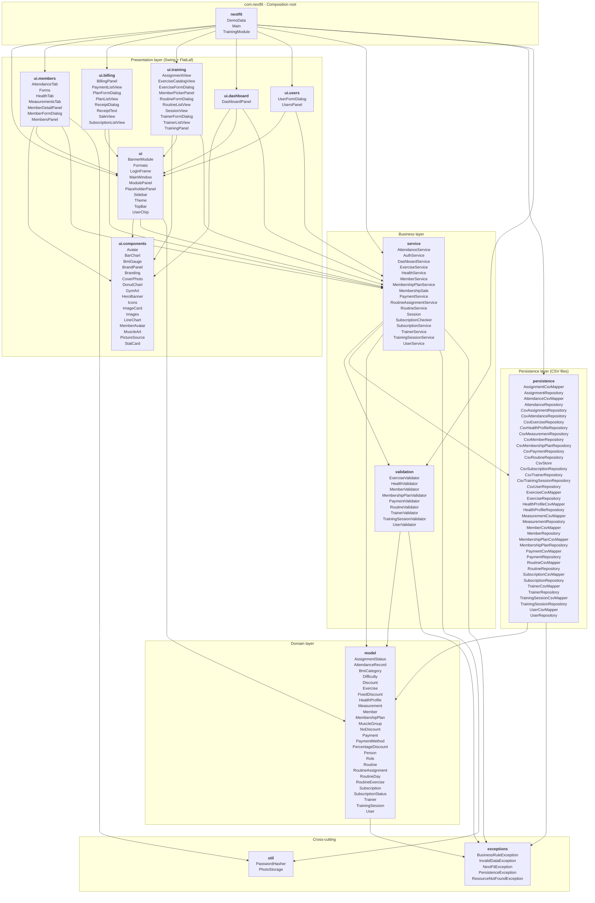
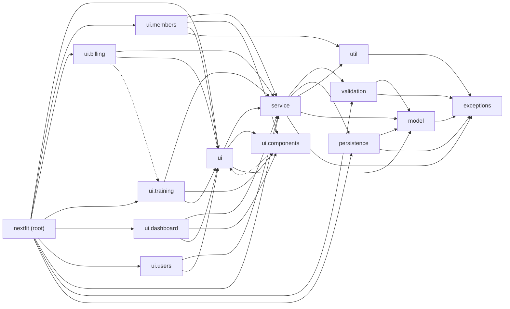

# Layers and Package Diagram

NextFit follows a layered architecture. Each arrow means "depends on" (it comes from the real `import` statements of the code). Dependencies only go downwards, towards the domain, with two small exceptions that are shown in the second diagram.

## Package diagram by layers

## Package dependencies (simplified)

Same dependencies with one node per package. The two dashed arrows are the known exceptions to a strict layering: `ui.components` reads the shared `Theme` from `ui`, and `ui.billing` reuses `MemberPickerPanel` from `ui.training`.

