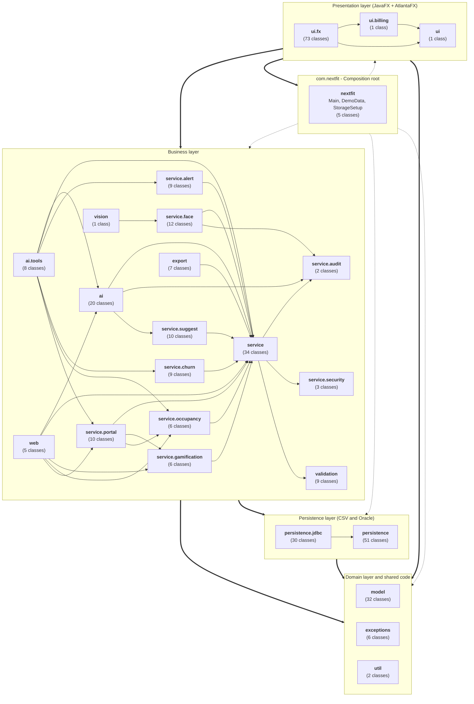

<!-- Generated by docs/tools/generate_docs.py from the source code. Do not edit by hand: run the script again. -->

# Layers and Package Diagram

NextFit follows a layered architecture. Each arrow means "depends on" and it comes from the real `import` statements of the code (the number is how many classes each package has). Dependencies only go downwards: the interface never touches the persistence, and the domain depends on nothing but its exceptions. Every package also uses `model` and `exceptions`; those arrows are not drawn so the diagram stays readable.

## Package diagram by layers

Thick arrows are dependencies between layers (they group the arrows between their packages); thin arrows are dependencies between packages of the same layer; dotted arrows show that the composition root creates the objects of every layer.

## Dependency rule

Checked against the imports: **no package depends on a higher layer.** The only package that knows every layer is the composition root (`Main`), which builds the objects and injects them.

## Layers and responsibilities

| Layer | Packages | Responsibility |
|---|---|---|
| Presentation layer (JavaFX + AtlantaFX) | `ui`, `ui.billing`, `ui.fx` | Shows data and collects what the user does. It never reads files or the database: it asks the services. |
| Business layer | `service`, `service.alert`, `service.audit`, `service.churn`, `service.face`, `service.gamification`, `service.occupancy`, `service.portal`, `service.security`, `service.suggest`, `validation`, `export`, `ai`, `ai.tools`, `web`, `vision` | Business rules, validation, use cases, reports, face recognition, the assistant and the phone server. |
| Persistence layer (CSV and Oracle) | `persistence`, `persistence.jdbc` | Repository interfaces and their two implementations: CSV files and Oracle through JDBC. |
| Domain layer and shared code | `model`, `exceptions`, `util` | Entities, enums and value objects with no dependencies, plus the exceptions and small helpers. |
| Composition root | `nextfit` | `Main` builds every object and injects the dependencies (Creator and Dependency Inversion). |
